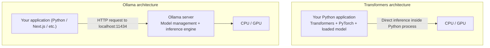

Hugging Face Transformers is primarily a library for working with models.
Ollama is a tool designed to make running and serving LLMs locally easier.
# Difference

|Feature|Hugging Face Transformers|Ollama|
|---|---|---|
|Primary purpose|Model development and inference|Local LLM inference and serving|
|Interface|Python code|CLI and HTTP API|
|Model loading|Explicitly load model and tokenizer|Automatically handled|
|Hardware management|More developer control|Mostly automatic|
|Quantization|Flexible, requires configuration|Easy access to quantized models|
|Local API server|Build or launch separately|Built in|
|Fine-tuning|Supported with additional libraries|Not designed for fine-tuning|
|Best suited for|ML experiments, fine-tuning, custom inference|Chatbots, agents, local applications|
## Therefore
If you're experimenting with how a model generates tokens, changing generation parameters, or fine-tuning LLaMA, Transformers offers greater control.

If you're building a chatbot that needs to call a locally running LLM, Ollama simplifies model deployment and API access.
# Running the same model using both approaches
## Using Hugging Face Transformers

```
from transformers import pipeline

llm = pipeline(
    "text-generation",
    model="Qwen/Qwen2.5-0.5B-Instruct"
)

response = llm(
    [{"role": "user", "content": "What is RAG?"}],
    max_new_tokens=100
)

print(response[0]["generated_text"][-1]["content"])
```

## Using Ollama

Run in your terminal:

```
ollama run qwen2.5:0.5b
```

Ollama downloads the model if necessary and lets you chat with it.

You can also access it from Python:

```
from ollama import chat

response = chat(
    model="qwen2.5:0.5b",
    messages=[
        {"role": "user", "content": "What is RAG?"}
    ]
)

print(response.message.content)
```

# Difference in how inference is executed


# Why Ollama is useful for building applications?
Imagine you're developing an AI agent with a Next.js frontend and a Python backend.

With Transformers, you could load the LLM into your Python backend. But if you want to share the model across multiple independently running applications, you would typically need to build or configure an inference server.

With Ollama, you already have a local server with an API. Your Python backend, Next.js application, and another agent can all send requests to that server. Ollama also manages model loading, memory residency, and request scheduling.

# Conclusion
- Transformers: When you want to experiment with model internals, fine-tune using LoRA/QLoRA, inspect logits, or customize inference.
- Ollama: When you have a ready model and want to run it locally as a service that your chatbot, LangChain agent, or application can call.