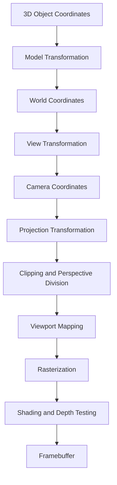
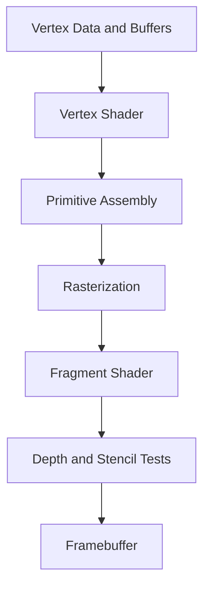
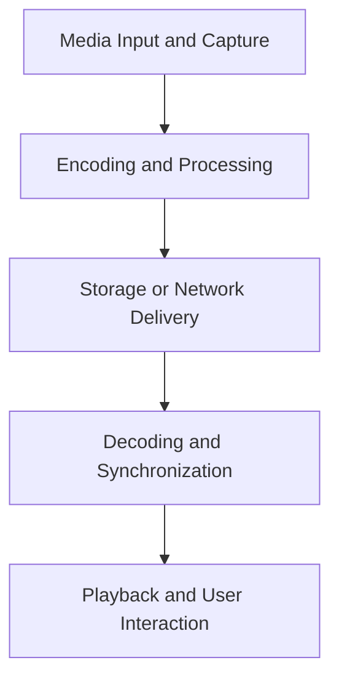
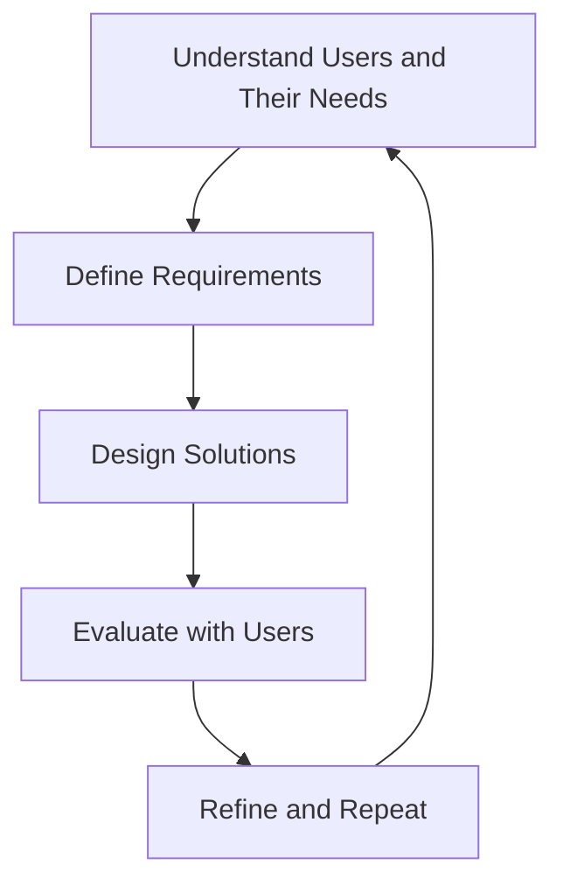
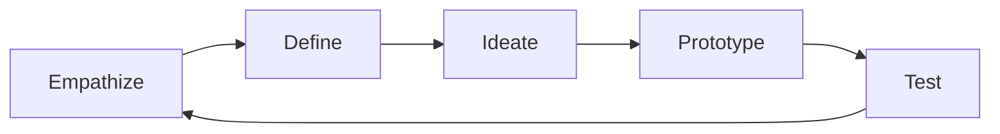
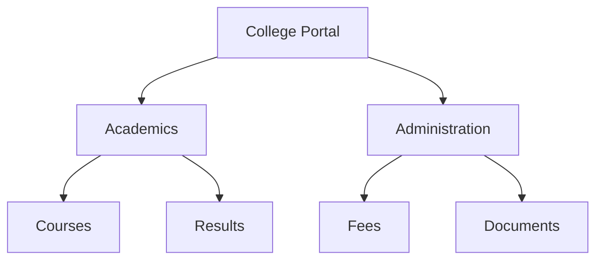
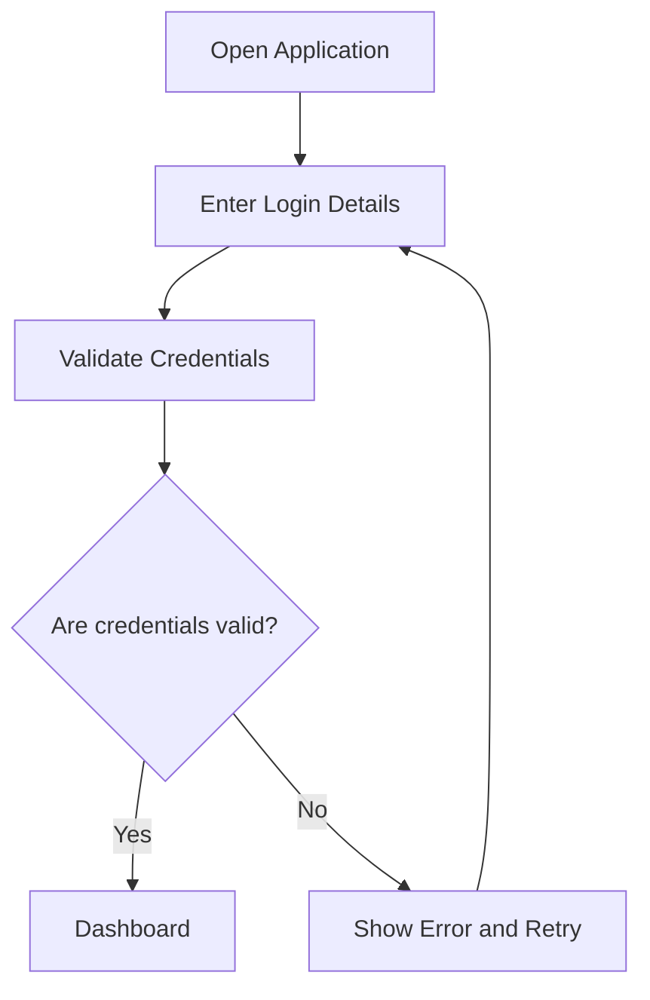

# Complete Study Notes: Units III, IV, and V

# UNIT III: Computer Graphics and Rendering

## 1. Camera and Viewing Concepts

### Definition

Camera and viewing concepts describe how a three-dimensional (3D) scene is observed and converted into a two-dimensional (2D) image.

A 3D scene may contain objects, lights, materials, and a camera. The camera determines which objects are visible, how they appear in the image, and how the scene is projected onto the screen.

### Important concepts

- **World coordinates:** The coordinate system used to position objects in a scene.
- **View coordinates:** Coordinates expressed relative to the camera.
- **Camera position:** The location from which the scene is viewed.
- **Viewing direction:** The direction in which the camera points.
- **View-up vector:** Specifies the camera's approximate upward direction.
- **Field of view (FOV):** The angular extent of the scene visible through the camera.
- **Aspect ratio:** The ratio of image width to image height.
- **Near and far clipping planes:** Define the depth range that can be rendered.

### Camera parameters

A camera is commonly described using:

1. Eye position or camera position.
2. Target point or viewing direction.
3. Up vector.
4. Projection type.
5. Field of view or viewing volume.
6. Near and far clipping distances.

### Example

Consider a 3D model of a car. Moving the camera around the car changes the viewpoint without necessarily changing the car's geometry.

- Front view shows the front of the car.
- Side view emphasizes its length.
- Top view reveals the roof and overall layout.
- Perspective view makes nearby parts appear larger than distant parts.

### Applications

- Video games.
- 3D modeling.
- Architectural visualization.
- Animation and filmmaking.
- Virtual reality.
- Scientific visualization.

---

## 2. Viewing Pipeline

### Definition

The viewing pipeline is the sequence of transformations that converts a 3D scene into a 2D image displayed on a screen.

### Stages of the viewing pipeline

1. **Model transformation:** Converts object coordinates into world coordinates.
2. **View transformation:** Converts world coordinates into camera or view coordinates.
3. **Projection transformation:** Projects 3D coordinates into a 2D-oriented viewing representation.
4. **Clipping:** Removes geometry outside the viewing volume.
5. **Perspective division:** For perspective projection, divides appropriate homogeneous coordinates by the homogeneous component.
6. **Viewport mapping:** Maps projected coordinates to screen coordinates.
7. **Rasterization:** Converts geometric primitives into fragments associated with screen samples.
8. **Fragment processing:** Calculates color and performs visibility tests.
9. **Framebuffer output:** Stores the final rendered image.

### Pipeline diagram



### Explanation

**Model transformation:** Places and orients an object in the world.

**View transformation:** Represents the scene relative to the camera.

**Projection transformation:** Determines how 3D points appear in a 2D image.

**Clipping:** Removes objects or portions of objects outside the viewing region.

**Viewport mapping:** Converts normalized projected coordinates into pixel-related screen coordinates.

**Rasterization:** Determines which screen samples are covered by geometric primitives.

### Example

A cube defined in its own local coordinate system is placed in a scene, viewed through a camera, projected onto the screen, and converted into pixels.

### Importance

The viewing pipeline separates object geometry, camera positioning, projection, and display operations. This makes 3D rendering easier to organize and implement.

---

## 3. Parallel Projection

### Definition

Parallel projection is a projection method in which projection rays remain parallel to one another.

It is commonly used in engineering drawings, CAD systems, and technical visualization because it preserves certain geometric relationships.

### Characteristics

- Parallel lines remain parallel under the projection.
- Apparent object size does not decrease merely because an object is farther away.
- Useful for technical drawings and measurements.
- Does not naturally reproduce the depth appearance of a human viewpoint.

### Types of parallel projection

#### 3.1 Orthographic projection

Projection rays are perpendicular to the projection plane.

Common views include:

- Front view.
- Side view.
- Top view.

Orthographic projection is useful when dimensions and proportions must remain consistent.

#### 3.2 Oblique projection

Projection rays meet the projection plane at an angle other than 90 degrees.

Examples include:

- Cavalier projection.
- Cabinet projection.

Oblique projection can show the front face of an object in its true shape while representing depth using angled lines.

#### 3.3 Axonometric projection

An object is oriented so that multiple faces can be seen in one view.

Common forms include:

- Isometric projection.
- Dimetric projection.
- Trimetric projection.

### Advantages

- Useful for technical measurements.
- Parallel edges remain parallel.
- Easy to compare dimensions.
- Suitable for CAD and engineering diagrams.

### Limitations

- Less realistic than perspective projection.
- Depth can be difficult to judge visually.
- Objects do not become smaller with distance.

### Applications

- Engineering drawings.
- Architectural plans.
- CAD.
- Technical illustrations.
- Strategy games using isometric views.

---

## 4. Perspective Projection

### Definition

Perspective projection represents a 3D scene in a way that approximates how a camera or human eye sees it.

Objects farther from the camera generally appear smaller than equally sized objects that are closer.

### Characteristics

- Parallel lines may converge toward vanishing points.
- Distant objects appear smaller.
- Provides a strong sense of depth.
- Commonly used in games, films, and realistic 3D visualization.

### Basic perspective projection

For a simplified camera model with focal length \(f\), a 3D point \((x,y,z)\) may be projected as:

$$
x'=\frac{fx}{z}
$$

$$
y'=\frac{fy}{z}
$$

Here:

- \(x,y,z\) are camera-space coordinates.
- \(f\) is the focal length.
- \(x',y'\) are projected image coordinates.

This simplified form assumes a camera looking along the positive \(z\)-axis and omits principal-point offsets and other camera parameters.

### Example

Suppose two identical cars are placed at different distances from the camera. The nearer car appears larger, while the farther car appears smaller.

### Advantages

- Creates realistic depth perception.
- Produces natural-looking scenes.
- Useful for immersive environments.

### Limitations

- Measurements are not directly preserved.
- Distant objects may become too small to see clearly.
- Projection and clipping require additional calculations.

### Parallel vs perspective projection

| Feature | Parallel projection | Perspective projection |
|---|---|---|
| Projection rays | Parallel | Converge toward a center of projection |
| Object size with distance | Does not inherently decrease | Generally decreases |
| Depth appearance | Less realistic | More realistic |
| Measurements | Better suited to technical views | More difficult to measure directly |
| Applications | CAD, engineering | Games, films, simulations |

---

## 5. Viewport Mapping

### Definition

Viewport mapping converts projected or normalized device coordinates into coordinates corresponding to a screen region called the viewport.

The viewport specifies where the rendered image appears on the display.

### Basic process

1. Transform a point into the appropriate projected coordinate system.
2. Convert normalized coordinates into viewport coordinates.
3. Account for the screen's coordinate convention.
4. Rasterize the resulting primitives.

Suppose normalized coordinates \(u,v\) lie between 0 and 1. A simple viewport mapping is:

$$
x_s=x_v+uW_v
$$

$$
y_s=y_v+vH_v
$$

Here:

- \(x_s,y_s\) are screen coordinates.
- \(x_v,y_v\) are the viewport's origin.
- \(W_v,H_v\) are viewport width and height.

The exact vertical mapping depends on whether the coordinate origin is at the top-left or bottom-left.

### Example

Suppose a viewport begins at \((100,50)\), has width 800 pixels, and height 600 pixels.

For normalized coordinates \((u,v)=(0.5,0.5)\):

$$
x_s=100+(0.5\times800)=500
$$

$$
y_s=50+(0.5\times600)=350
$$

The point maps to \((500,350)\).

### Applications

- Rendering into application windows.
- Split-screen games.
- Minimap rendering.
- Multiple camera views.
- Responsive graphics layouts.

---

## 6. 3D Object Representation

### Definition

3D object representation describes how the geometry, shape, and surface properties of objects are stored in a computer.

Different representations are useful for different applications.

### Common methods

#### 6.1 Wireframe representation

Represents an object using vertices and edges.

Advantages:
- Simple and memory-efficient for basic shapes.
- Useful for visualizing structural geometry.
- Easy to inspect connections.

Limitations:
- Does not inherently represent filled surfaces.
- Overlapping edges can make shapes confusing.

#### 6.2 Surface representation

Represents the object's exterior using surfaces, often polygons or curved patches.

Applications include:
- Character models.
- CAD surfaces.
- Architectural visualization.

#### 6.3 Solid representation

Represents a complete 3D solid, including its interior or volume.

Examples:
- Constructive solid geometry.
- Boundary representation.
- Voxel-based models.

#### 6.4 Boundary representation

Represents a solid through its boundary elements, such as vertices, edges, and faces.

#### 6.5 Constructive Solid Geometry

Constructive Solid Geometry (CSG) creates complex objects using Boolean operations on simpler solids.

Common operations:
- Union.
- Intersection.
- Difference.

Example: Subtracting a cylinder from a cube creates a hole through the cube.

#### 6.6 Voxel representation

A voxel is a volume element, analogous to a pixel in a 2D image.

Voxel representations are used in:
- Medical imaging.
- Scientific simulations.
- Volumetric visualization.

### Comparison

| Representation | Basic idea | Common use |
|---|---|---|
| Wireframe | Vertices and edges | Structural visualization |
| Surface mesh | Polygonal surface | Games and animation |
| Solid model | Complete volume | CAD and manufacturing |
| CSG | Boolean combinations of solids | Geometric modeling |
| Voxel | 3D grid of volume samples | Medical and scientific data |

---

## 7. Polygon Meshes

### Definition

A polygon mesh is a representation of a 3D surface using connected vertices, edges, and faces.

Triangles and quadrilaterals are common mesh faces.

### Components

- **Vertex:** A point in 3D space.
- **Edge:** A connection between two vertices.
- **Face:** A polygon bounded by edges.
- **Normal:** A vector describing a surface's orientation.
- **Topology:** The connectivity relationships among vertices, edges, and faces.

### Example

A cube can be represented using eight vertices and six quadrilateral faces.

A triangle mesh represents each surface using triangles. Triangles are especially convenient for GPU rendering because any three non-collinear vertices define a planar triangle.

### Advantages

- Flexible representation of complex shapes.
- Efficient support in graphics hardware.
- Suitable for animation and deformation.
- Supports texture mapping and shading.

### Limitations

- High-resolution meshes can consume substantial memory.
- Poor topology may cause rendering or deformation problems.
- Mesh simplification can remove important details.

### Mesh quality considerations

- Vertex density.
- Face orientation.
- Triangle quality.
- Surface continuity.
- Topology.
- Normal consistency.

### Applications

- 3D games.
- Animation.
- CAD visualization.
- 3D printing.
- Product visualization.

---

## 8. Hidden Surface Removal

### Definition

Hidden surface removal determines which surfaces are visible from a particular camera position and which surfaces are blocked by other objects.

Without visibility processing, surfaces behind other objects might incorrectly appear in the rendered image.

### Common methods

#### 8.1 Back-face culling

Removes polygon faces that point away from the camera under the relevant winding and orientation conventions.

Advantages:
- Reduces unnecessary rendering.
- Computationally inexpensive.

Limitation:
- Does not resolve all visibility problems between overlapping front-facing surfaces.

#### 8.2 Z-buffer algorithm

Stores depth information for each screen pixel or sample and compares the depths of competing fragments.

#### 8.3 Painter's algorithm

Renders surfaces from farthest to nearest so that nearer surfaces overwrite farther ones.

Limitation:
- Complex overlapping geometry can produce ordering problems.
- Intersecting surfaces may require splitting.

#### 8.4 Scan-line methods

Process the image one horizontal scan line at a time while determining visible surface spans.

#### 8.5 Ray-based visibility

Uses ray-object intersection tests to identify the nearest surface along each ray.

### Importance

Hidden surface removal improves correctness and prevents geometry behind visible surfaces from appearing in the final image.

---

## 9. Z-Buffer or Depth Buffer

### Definition

A Z-buffer is a buffer that stores depth values associated with screen pixels or samples. It helps determine which surface is closest to the camera.

### Working

1. Initialize the depth buffer to a value representing the farthest depth under the chosen convention.
2. Rasterize a polygon.
3. Calculate the depth of each covered fragment.
4. Compare it with the stored depth.
5. If the fragment is closer, update the depth buffer and usually the color buffer.
6. Otherwise, reject the fragment.

### Pseudocode

```text
For each pixel:
    depthBuffer[pixel] = farthestDepth

For each polygon:
    For each covered pixel:
        newDepth = calculateDepth(polygon, pixel)

        If newDepth is closer than depthBuffer[pixel]:
            depthBuffer[pixel] = newDepth
            colorBuffer[pixel] = polygonColor
```

The comparison direction depends on the depth convention. Some rendering systems use reversed-Z depth.

### Advantages

- Simple and widely supported.
- Works with intersecting and overlapping polygons.
- Suitable for complex 3D scenes.
- Efficiently implemented in GPUs.

### Limitations

- Consumes memory.
- Limited depth precision can cause z-fighting.
- Transparent surfaces require additional handling.

### Z-fighting

Z-fighting occurs when surfaces have nearly identical depth values and the depth buffer cannot reliably distinguish them.

It may produce flickering or alternating surface patterns.

Possible remedies include:
- Improving the near and far clipping range.
- Avoiding nearly coplanar surfaces.
- Using suitable depth precision.
- Applying polygon offset where appropriate.

### Applications

- Games.
- CAD.
- 3D visualization.
- Real-time rendering.

---

## 10. Illumination Models

### Definition

An illumination model describes how light interacts with surfaces and contributes to the color or brightness of the rendered image.

Illumination models may approximate lighting or simulate more physically based light behavior.

### Main components of a simple local illumination model

- Ambient component.
- Diffuse component.
- Specular component.

A simplified combined model is:

$$
I=I_a+I_d+I_s
$$

Here:
- \(I_a\) is the ambient contribution.
- \(I_d\) is the diffuse contribution.
- \(I_s\) is the specular contribution.

This equation represents a conceptual sum. Actual renderers may use more complex material, light, visibility, and energy calculations.

---

## 11. Ambient Illumination

### Definition

Ambient illumination approximates general background lighting that appears to come from many directions.

It is often used to prevent surfaces from becoming completely black when direct illumination is absent.

### Simplified formula

$$
I_a=k_aI_{\text{ambient}}
$$

Here:
- \(k_a\) is the ambient material coefficient.
- \(I_{\text{ambient}}\) is the ambient light intensity.

### Characteristics

- Does not depend on a particular light direction in this simplified model.
- Does not inherently account for occlusion.
- Provides a basic baseline of illumination.

### Example

The side of a cube facing away from a light source may still receive some ambient contribution.

### Advantages

- Simple to compute.
- Prevents completely dark surfaces in basic models.

### Limitations

- Does not reproduce realistic indirect illumination.
- Can make surfaces appear flat.
- May incorrectly brighten areas that should be in shadow.

Modern renderers often use environment lighting, ambient occlusion, or global illumination techniques for more convincing results.

---

## 12. Diffuse Reflection

### Definition

Diffuse reflection describes light scattered by a rough surface in many directions. In the ideal Lambertian model, apparent brightness depends on the angle between the surface normal and the direction toward the light.

### Lambertian diffuse formula

$$
I_d=k_dI_l\max(0,\mathbf{N}\cdot\mathbf{L})
$$

Here:
- \(k_d\) is the diffuse reflection coefficient.
- \(I_l\) is the incident light intensity.
- \(\mathbf{N}\) is the normalized surface normal.
- \(\mathbf{L}\) is the normalized direction toward the light.

The dot product measures how directly the surface faces the light.

### Characteristics

- Commonly associated with matte surfaces.
- Brightest when the surface faces the light.
- Decreases as the angle becomes more oblique.
- Does not create sharp highlights in the ideal diffuse model.

### Example

A matte white wall appears brighter when illuminated directly than when the same wall is turned away from the light.

### Applications

- Basic object shading.
- Matte materials.
- Real-time rendering.
- Lighting calculations.

---

## 13. Specular Reflection

### Definition

Specular reflection represents directional highlights produced by reflected light.

It is especially noticeable on polished or glossy surfaces.

### Phong specular term

$$
I_s=k_sI_l\max(0,\mathbf{R}\cdot\mathbf{V})^n
$$

Here:
- \(k_s\) is the specular reflection coefficient.
- \(I_l\) is the light intensity.
- \(\mathbf{R}\) is the ideal reflected light direction.
- \(\mathbf{V}\) is the direction toward the viewer.
- \(n\) is the shininess exponent.

### Characteristics

- Produces highlights.
- Depends on the light direction and viewing direction.
- Larger shininess exponents generally create narrower highlights in the classic Phong model.
- Helps distinguish glossy from matte materials.

### Example

A polished metal sphere may show a bright highlight where the reflected light direction aligns with the viewer.

### Diffuse vs specular reflection

| Feature | Diffuse | Specular |
|---|---|---|
| Appearance | Matte | Glossy highlight |
| Main dependency | Surface normal and light direction | Light, reflection direction, and view direction |
| Typical use | Chalk, matte paint | Polished metal, glossy plastic |
| Highlight | Broad or absent in ideal diffuse model | Directional highlight |

---

## 14. Flat Shading

### Definition

Flat shading calculates lighting for each polygon face and applies a uniform color across that face.

### Working

1. Determine the polygon's surface normal.
2. Calculate illumination using the normal and lighting model.
3. Assign the calculated color to the face.
4. Rasterize the face.

### Advantages

- Computationally simple.
- Makes polygon boundaries visible.
- Useful for low-polygon art and quick previews.

### Limitations

- Curved surfaces may look faceted.
- Adjacent faces may have abrupt color changes.
- Surface smoothness is not represented well by coarse meshes.

### Example

A low-polygon sphere rendered using flat shading appears to have distinct planar faces.

---

## 15. Gouraud Shading

### Definition

Gouraud shading calculates lighting at polygon vertices and interpolates the resulting vertex colors across the polygon.

### Working

1. Calculate or average vertex normals.
2. Compute lighting at each vertex.
3. Assign a color to each vertex.
4. Interpolate the colors across the polygon during rasterization.

### Advantages

- Smoother appearance than flat shading.
- Often inexpensive.
- Reduces visible differences between adjacent faces.

### Limitations

- Small specular highlights may be missed if they do not occur near a vertex.
- Interpolating colors is not equivalent to evaluating lighting at every pixel.

### Example

A polygonal sphere appears smoother than a flat-shaded sphere because colors gradually change across its faces.

---

## 16. Phong Shading

### Definition

Phong shading interpolates surface normals across a polygon and evaluates the illumination model at each pixel or fragment.

It should not be confused with the Phong illumination model, which describes ambient, diffuse, and specular contributions.

### Working

1. Calculate vertex normals.
2. Interpolate normals across each polygon.
3. Normalize the interpolated normal.
4. Evaluate the lighting model at each fragment.
5. Produce the final fragment color.

### Advantages

- Produces smooth surface appearance.
- Represents specular highlights more accurately than Gouraud shading in many cases.
- Useful for shiny and curved surfaces.

### Limitations

- Requires more lighting calculations.
- Quality depends on mesh normals and interpolation.

### Comparison of shading techniques

| Feature | Flat shading | Gouraud shading | Phong shading |
|---|---|---|---|
| Lighting calculation | Per face | Per vertex | Per fragment |
| Interpolated quantity | None across the face | Color | Normal |
| Smooth appearance | Low on coarse meshes | Better | Generally very good |
| Specular highlights | Face-based | May miss small highlights | Better representation |
| Computational cost | Low | Moderate | Generally higher |

---

## 17. Texture Mapping

### Definition

Texture mapping applies image data or other texture information to the surface of a 3D object.

Textures can represent:
- Color.
- Roughness.
- Metallic properties.
- Surface normals.
- Height or displacement.
- Transparency.

### Working

1. Create or obtain a texture.
2. Define how the texture corresponds to the object's surface.
3. Assign texture coordinates.
4. Sample the texture during rendering.
5. Combine the texture with material and lighting calculations.

### Example

A plain cube can be given the appearance of a brick wall by applying a brick texture to its faces.

### Common texture types

**Color or albedo texture:** Represents the surface's base color.

**Normal map:** Modifies the apparent orientation used for lighting without necessarily changing the actual mesh geometry.

**Roughness map:** Controls the variation in surface roughness.

**Metallic map:** Controls metallic material properties in a physically based material workflow.

**Height map:** Represents surface height and may be used for displacement or parallax effects.

### Advantages

- Adds visual detail without requiring equally dense geometry.
- Supports complex surface appearances.
- Reduces the need to model every small detail.

### Limitations

- Texture memory can be substantial.
- Poor mapping may cause visible stretching or seams.
- Incorrect texture resolution can cause blur or aliasing.

---

## 18. UV Mapping

### Definition

UV mapping defines how points on a 3D object's surface correspond to positions in a 2D texture.

The letters U and V are commonly used for the two texture-coordinate axes.

### Basic concept

A 3D mesh has geometric coordinates, while a texture has 2D coordinates. UV mapping connects the two.

For example:

$$
(u,v)\in[0,1]\times[0,1]
$$

A UV coordinate of \((0,0)\) often represents one corner of the texture, while \((1,1)\) represents the opposite corner, depending on the texture convention.

### UV unwrapping

UV unwrapping flattens a 3D surface into a 2D layout so a texture can be applied.

### Common mapping approaches

- Planar mapping.
- Cylindrical mapping.
- Spherical mapping.
- Cube mapping.
- Manual UV unwrapping.

### Example

A character model may use a UV map to place the correct image regions on the face, clothing, hands and shoes.

### UV mapping vs texture mapping

UV mapping defines the correspondence between the surface and texture coordinates.

Texture mapping uses those coordinates to apply and sample the texture.

---

## 19. Materials and Surface Appearance

### Definition

A material describes how a surface interacts with light and how it appears during rendering.

A material may define color, roughness, metallic behavior, transparency, emission and other properties.

### Important properties

**Base color:** The underlying surface color.

**Roughness:** Controls the spread and sharpness of specular reflections in many material models.

**Metallic:** Controls whether a material is treated as metallic in a metallic-roughness workflow.

**Transparency or opacity:** Controls how much of the surface is opaque.

**Emission:** Represents light emitted by the material.

**Normal information:** Affects the orientation used in lighting calculations.

### Physically Based Rendering

Physically Based Rendering (PBR) uses material and lighting models designed to produce plausible and consistent surface appearance.

Common PBR properties include:
- Base color.
- Metallic.
- Roughness.
- Normal map.
- Ambient occlusion.
- Emission.

### Example

A metal sphere and a rough wooden sphere can have similar geometric shapes but look different because their materials interact with light differently.

### Applications

- Game engines.
- Product visualization.
- Architectural rendering.
- Animation.
- Realistic 3D modeling.

---

## 20. Rasterization

### Definition

Rasterization converts geometric primitives, such as triangles, into fragments corresponding to potential screen pixels.

It is a central stage in conventional real-time graphics pipelines.

### Working

1. Assemble vertices into primitives.
2. Clip geometry outside the viewing region.
3. Transform geometry into screen-related coordinates.
4. Determine which pixel samples are covered by each primitive.
5. Interpolate relevant attributes.
6. Run fragment shading.
7. Perform depth and other tests.
8. Write the result to the framebuffer.

### Advantages

- Highly efficient for large numbers of triangles.
- Supported by specialized GPU hardware.
- Well suited to interactive applications.

### Limitations

- Traditional rasterization does not automatically calculate all physical light paths.
- Reflections, shadows and indirect lighting may require additional techniques.

### Rasterization vs ray tracing

| Feature | Rasterization | Ray tracing |
|---|---|---|
| Basic approach | Projects and fills geometry | Traces rays and tests intersections |
| Performance | Generally very fast | Often more computationally expensive |
| Reflections | Often approximated or supplemented | Can calculate ray-based reflections |
| Shadows | Commonly use shadow maps or other methods | Can use shadow rays |
| Typical use | Real-time games and interfaces | Offline rendering and increasingly real-time graphics |

Modern rendering engines often combine both approaches.

---

## 21. Ray Tracing

### Definition

Ray tracing simulates the paths of rays through a scene to determine what light reaches a camera or sensor.

A basic ray tracer casts rays from the camera through image pixels and finds the nearest intersected surface.

### Basic algorithm

1. Generate a ray through a pixel.
2. Find the nearest object intersected by the ray.
3. Determine the intersection point and surface normal.
4. Calculate direct illumination and shadows.
5. Optionally trace reflection, refraction or indirect-light rays.
6. Combine the contributions to produce the pixel color.

### Types of rays

- **Primary rays:** Travel from the camera into the scene.
- **Shadow rays:** Test whether a light source is blocked.
- **Reflection rays:** Follow reflected directions.
- **Refraction rays:** Follow transmitted light through transparent materials.

### Advantages

- Produces convincing reflections and shadows.
- Can model refraction and indirect illumination.
- Supports realistic lighting effects.

### Disadvantages

- Can be computationally expensive.
- Complex scenes may require many ray-object intersection tests.
- Noise can appear in stochastic rendering when sampling is insufficient.

### Applications

- Film rendering.
- Architectural visualization.
- Product visualization.
- Real-time games using hardware-accelerated ray tracing.

---

## 22. Real-Time Rendering

### Definition

Real-time rendering generates images quickly enough for interactive applications. The image updates as the user moves, interacts or changes the scene.

Examples include video games, simulators, virtual reality and interactive 3D viewers.

### Frame rate

Frame rate is the number of frames displayed per second, measured in FPS.

$$
\text{Frame time}=\frac{1000}{\text{FPS}}\text{ milliseconds}
$$

| Frame rate | Time per frame |
|---:|---:|
| 30 FPS | 33.33 ms |
| 60 FPS | 16.67 ms |
| 120 FPS | 8.33 ms |
| 144 FPS | 6.94 ms |

At 60 FPS, the renderer needs to sustain approximately one completed frame every 16.67 milliseconds.

### Optimization techniques

- Level of detail (LOD).
- Frustum culling.
- Occlusion culling.
- Texture compression.
- Shadow maps.
- Temporal anti-aliasing.
- GPU parallel processing.
- Resolution scaling.

### Applications

- Games.
- Driving and flight simulators.
- Augmented and virtual reality.
- Architectural visualization.
- Interactive medical visualization.

---

## 23. GPU-Based Rendering

### Definition

A Graphics Processing Unit (GPU) is a processor designed to execute large numbers of graphics and parallel computations efficiently.

Unlike a CPU, which is optimized for a broad range of tasks and complex control flows, a GPU is particularly effective when many similar operations can be performed simultaneously.

### Simplified GPU rendering pipeline



### Main components

**Vertex shader:** Processes vertices and transforms their positions.

**Rasterizer:** Converts primitives into fragments.

**Fragment shader:** Calculates fragment properties such as color.

**Depth buffer:** Helps resolve visibility.

**Framebuffer:** Stores output color and possibly depth, stencil and other values.

**GPU memory:** Stores geometry, textures, buffers and rendering resources.

### Advantages

- Parallel processing of vertices and fragments.
- High throughput for graphics operations.
- Supports interactive 3D scenes and advanced visual effects.

### Limitations

- GPU memory is finite.
- Transferring data between CPU and GPU can be costly.
- Performance depends on memory bandwidth, shader complexity and the rendering workload.

### Unit III Quick Revision

| Topic | Key point |
|---|---|
| Camera and viewing | Determines the viewpoint of a 3D scene |
| Viewing pipeline | Converts scene geometry into a displayed image |
| Parallel projection | Projection rays remain parallel |
| Perspective projection | Apparent size generally decreases with distance |
| Viewport mapping | Maps projected coordinates to screen coordinates |
| 3D representation | Describes geometry and volume |
| Polygon mesh | Uses vertices, edges and faces |
| Hidden surface removal | Determines visible surfaces |
| Z-buffer | Stores depth per pixel or sample |
| Ambient illumination | Approximates general background light |
| Diffuse reflection | Matte surface response |
| Specular reflection | Directional highlights |
| Flat shading | Lighting per face |
| Gouraud shading | Lighting at vertices, interpolated colors |
| Phong shading | Interpolated normals, lighting per fragment |
| Texture mapping | Applies texture data to a surface |
| UV mapping | Maps surface locations to 2D texture coordinates |
| Materials | Describe surface appearance and light interaction |
| Rasterization | Converts primitives into fragments |
| Ray tracing | Calculates visibility and light paths using rays |
| Real-time rendering | Produces frames quickly for interaction |
| GPU rendering | Uses parallel hardware for graphics computations |

---

# UNIT IV: Multimedia

## 1. Introduction to Multimedia

### Definition

Multimedia is the integration of two or more forms of media, such as text, images, audio, video and animation, to communicate information.

A multimedia application may allow users to view content, listen to narration, interact with controls and explore information.

### Major media elements

- Text.
- Graphics and images.
- Audio.
- Video.
- Animation.
- Interactivity.

### Example

An educational application combining written explanations, diagrams, recorded narration, animations and quizzes is a multimedia system.

---

## 2. Characteristics of Multimedia

### 2.1 Integration

Different media types are combined into one presentation.

Example: A video lecture includes a presenter, slides, narration and captions.

### 2.2 Interactivity

Users can influence the presentation through actions such as clicking, typing or selecting options.

Example: An interactive map allows users to zoom and select locations.

### 2.3 Digital representation

Digital multimedia stores information as binary data, allowing computers to process, copy and transmit it.

### 2.4 Non-linear navigation

Users can move between sections without following a fixed sequence.

Example: A website lets users jump directly to a topic through a navigation menu.

### 2.5 Synchronization

Related media must be coordinated in time.

Example: Video frames and spoken dialogue must remain synchronized.

### 2.6 Large storage and bandwidth requirements

Audio, images and video can require significant storage space and network bandwidth.

### 2.7 User engagement

Combining different media can make information easier to explore and understand when each element serves a clear purpose.

---

## 3. Applications of Multimedia

| Field | Application |
|---|---|
| Education | E-learning, simulations, interactive lessons |
| Entertainment | Films, games, music videos |
| Business | Presentations, product demonstrations |
| Healthcare | Medical training, imaging visualization |
| Communication | Video conferencing, social media |
| Advertising | Digital advertisements and interactive campaigns |
| Engineering | CAD visualization and simulation |
| Tourism | Virtual tours and interactive maps |
| E-commerce | Product galleries and demonstration videos |

---

## 4. Multimedia System Components

A multimedia system includes hardware and software for capturing, processing, storing, transmitting and presenting media.

### Hardware components

- CPU and GPU.
- RAM and storage.
- Microphones and audio interfaces.
- Cameras and scanners.
- Speakers and headphones.
- Displays and projectors.
- Network interfaces.

### Software components

- Image editors.
- Audio recording and editing software.
- Video editors.
- Animation tools.
- Media players.
- Codecs and encoding software.
- Streaming and content delivery software.

### Example

To create an instructional video, a user records footage with a camera, captures narration through a microphone, edits both using video software, exports a compressed video and distributes it through a streaming platform.

---

## 5. Multimedia Architecture

### Definition

Multimedia architecture describes how media data moves through a system from capture or storage to processing, delivery and playback.

### Typical architecture



### Explanation

1. **Capture:** Acquires images, sound or video.
2. **Encoding:** Converts media into a suitable digital representation and may compress it.
3. **Storage:** Saves media files or segments.
4. **Transmission:** Transfers media across a network when required.
5. **Decoding:** Reconstructs the media representation for playback.
6. **Synchronization:** Coordinates audio, video, captions and other timed elements.
7. **Presentation:** Displays or plays the media.

Not every multimedia system uses a network. An offline presentation may store and play all its resources locally.

---

## 6. Multimedia Authoring

### Definition

Multimedia authoring is the process of creating an application or presentation by combining media resources, arranging their timing and layout, and defining user interactions.

### Main stages

1. Planning and defining objectives.
2. Preparing a storyboard or content outline.
3. Collecting or creating media assets.
4. Editing and organizing assets.
5. Adding navigation and interaction.
6. Testing and correcting errors.
7. Publishing or exporting the final project.

### Types of authoring tools

**Card or page-based tools:** Organize information into pages or screens.

Example: An interactive educational presentation.

**Icon or event-based tools:** Use events and actions to control how content behaves.

Example: A presentation that starts an animation when a user clicks a button.

**Timeline-based tools:** Arrange media on tracks according to time.

Examples: Video editors and animation software.

### Authoring vs editing

Editing focuses on modifying individual media assets. Authoring combines assets and often defines the overall structure and behavior of the final multimedia experience.

---

## 7. Text in Multimedia

Text communicates labels, instructions, descriptions, captions and detailed information.

### Types of text

- **Plain text:** Unformatted characters.
- **Formatted text:** Includes fonts, colors, size, boldness and alignment.
- **Hypertext:** Text containing links to other content.
- **Captions and subtitles:** Text synchronized with audio or video.

### Important design principles

- Use readable fonts.
- Establish a clear heading hierarchy.
- Maintain sufficient contrast.
- Avoid excessive decorative typography.
- Keep paragraphs and labels easy to scan.
- Use captions when needed for accessibility.

### Example

A tutorial video may include a title, section headings, on-screen instructions and subtitles. Each text element should be readable and timed appropriately.

---

## 8. Graphics in Multimedia

Graphics are visual elements used to represent objects, concepts, data or decoration.

### Types of graphics

#### Raster graphics

Images made of pixels.

Examples:
- Photographs.
- Screenshots.
- Scanned pictures.

#### Vector graphics

Images represented using mathematical paths and shapes.

Examples:
- Logos.
- Icons.
- Diagrams.

### Raster vs vector graphics

| Feature | Raster | Vector |
|---|---|---|
| Structure | Pixels | Paths and geometric shapes |
| Scaling | Can become pixelated | Usually remains sharp |
| Best suited for | Photographs and detailed images | Logos, icons and diagrams |
| Typical formats | JPEG, PNG, WebP | SVG |

Vector graphics can contain raster images, and some raster formats can store additional metadata, but the distinction above describes their primary representation.

---

## 9. Digital Images

### Definition

A digital image is a representation of visual information in a digital format.

### Pixels

A pixel is a picture element, usually representing a sample of color or intensity at a particular location in an image.

A 1920 × 1080 image contains:

$$
1920\times1080=2,073,600\text{ pixels}
$$

This is approximately 2.07 megapixels.

### Resolution

Resolution commonly refers to the dimensions of an image in pixels.

A higher pixel count can preserve more detail, provided that the original image contains that detail.

### Color depth

Color depth indicates how many bits are used to represent a pixel or its channels.

For an RGB image with 8 bits per channel:

$$
2^8=256\text{ levels per channel}
$$

$$
256^3=16,777,216\text{ possible RGB colors}
$$

This is commonly called 24-bit RGB color.

### Uncompressed image storage

For an uncompressed image:

$$
\text{Size in bytes}=
\frac{W\times H\times C}{8}
$$

Here:
- \(W\) is image width.
- \(H\) is image height.
- \(C\) is the number of bits per pixel.

For a 1920 × 1080 image with 24 bits per pixel:

$$
\frac{1920\times1080\times24}{8}
=6,220,800\text{ bytes}
$$

This is approximately 5.93 MiB before accounting for headers, padding and other storage details.

---

## 10. Image File Formats

### 10.1 JPEG or JPG

JPEG is a raster image format commonly using lossy compression.

**Advantages**
- Often produces small file sizes.
- Suitable for photographs.
- Widely supported.

**Limitations**
- Lossy compression can introduce artifacts.
- Repeated lossy editing or saving may reduce quality.
- Transparency is not part of the conventional JPEG format.

**Uses:** Photographs, web images and digital photography.

### 10.2 PNG

PNG is a raster format using lossless compression.

**Advantages**
- Preserves pixel values.
- Supports transparency.
- Suitable for sharp edges and text.

**Limitations**
- Photographs may produce larger files than JPEG.

**Uses:** Screenshots, interface assets, logos and transparent images.

### 10.3 GIF

GIF supports indexed color, basic transparency and simple frame-based animation.

**Advantages**
- Broad support for simple animations.
- Can display looping animations.

**Limitations**
- Limited palette of up to 256 colors per frame.
- Less suitable for photographic images.

**Uses:** Simple animated graphics and short looping animations.

### 10.4 TIFF

TIFF is a flexible raster image format used in scanning, publishing and archival workflows.

**Advantages**
- Supports high-quality image data.
- Supports several compression options.
- Can store extensive image information.

**Limitations**
- Files can be large.
- Support varies across applications.

**Uses:** Scanning, print production and archival workflows.

### 10.5 SVG

SVG is an XML-based vector graphics format.

**Advantages**
- Scales cleanly.
- Supports geometric shapes and text.
- Can be edited as structured vector content.

**Limitations**
- Complex filters or highly detailed artwork may be expensive to render.
- Not ideal as the primary format for ordinary photographs.

**Uses:** Logos, icons, diagrams and web illustrations.

### 10.6 WebP

WebP is a web-focused image format supporting lossy and lossless compression, transparency and animation.

**Advantages**
- Can provide efficient file sizes for web delivery.
- Supports transparency.
- Supports animated images.

**Limitations**
- Compatibility and feature support should be checked for older software or workflows.

**Uses:** Web images, interface graphics and animated web content.

### Format selection

| Requirement | Suitable choice |
|---|---|
| Photographs with small file sizes | JPEG or lossy WebP |
| Transparent interface graphics | PNG or WebP |
| Simple animated images | GIF or animated WebP |
| Scalable logos and icons | SVG |
| Archival or print workflows | TIFF, depending on requirements |
| Screenshots with sharp text | PNG is often suitable |

---

## 11. Digital Audio

### Definition

Digital audio represents sound as numerical samples that a computer can store, process and reproduce.

A microphone converts sound pressure variations into an electrical signal. An analog-to-digital converter then samples and quantizes the signal.

### Important terms

- **Amplitude:** Magnitude of the signal, related to perceived loudness.
- **Frequency:** Number of oscillations per second, measured in hertz (Hz).
- **Sampling rate:** Number of audio samples taken per second.
- **Bit depth:** Number of bits used to represent each sample.
- **Channels:** Separate audio streams, such as left and right stereo channels.

---

## 12. Sampling

### Definition

Sampling measures an analog signal at regular intervals to produce discrete-time values.

The sampling rate determines how many samples are taken per second.

Examples:
- 8,000 Hz means 8,000 samples per second.
- 44,100 Hz means 44,100 samples per second.
- 48,000 Hz means 48,000 samples per second.

### Nyquist sampling principle

For an ideal band-limited signal, the sampling rate must exceed twice the highest frequency present to allow reconstruction under the sampling theorem.

$$
f_s>2f_{\max}
$$

Here:
- \(f_s\) is the sampling rate.
- \(f_{\max}\) is the highest signal frequency.

In practice, audio systems use anti-aliasing filters before sampling.

**Example:** A 48 kHz audio system can represent frequencies up to below 24 kHz under ideal sampling conditions, with practical limitations determined by filtering and system design.

### Aliasing

Aliasing occurs when frequencies above the supported range are not properly removed before sampling. These frequencies may appear as incorrect lower frequencies in the digital signal.

---

## 13. Quantization

### Definition

Quantization maps each sampled amplitude to one of a finite set of representable values.

If a sample uses \(n\) bits, the number of possible levels is:

$$
L=2^n
$$

Examples:
- 8-bit: 256 possible levels.
- 16-bit: 65,536 possible levels.
- 24-bit: 16,777,216 possible levels.

Increasing bit depth can reduce quantization error and increase the representable dynamic range.

For ideal uniform quantization, each additional bit provides approximately 6 dB of additional theoretical signal-to-quantization-noise ratio under standard assumptions.

**Difference to remember:** Sampling discretizes time, while quantization discretizes amplitude.

---

## 14. Audio Bit Rate

### Definition

Bit rate is the number of bits processed or transmitted per second.

For uncompressed PCM audio:

$$
\text{Bit rate}=f_s\times b\times c
$$

where:
- \(f_s\) is the sampling rate.
- \(b\) is the number of bits per sample.
- \(c\) is the number of channels.

### Example

For stereo audio at 44,100 Hz with 16 bits per sample:

$$
44,100\times16\times2
=1,411,200\text{ bits/s}
$$

Therefore, the uncompressed bit rate is 1,411.2 kbps.

For compressed audio, the actual bit rate depends on the codec and encoding settings, not just the sampling rate and bit depth.

---

## 15. Audio Channels

Audio channels represent separate audio signals.

### Mono

One audio channel.

Common uses:
- Telephone calls.
- Voice announcements.
- Simple recordings.

### Stereo

Two channels, commonly left and right.

Common uses:
- Music.
- Headphones.
- General media playback.

### 5.1 Surround

Six channels, conventionally including five main channels and one low-frequency effects channel.

Common uses:
- Films.
- Games.
- Home theater systems.

### 7.1 Surround

Eight channels in a common configuration.

**Important:** A stereo file is not necessarily higher quality than a mono file. Quality also depends on recording, encoding and playback.

---

## 16. Audio File Formats

| Format | Characteristics | Common use |
|---|---|---|
| WAV | Container commonly used for PCM audio; can also support other encodings | Recording and editing |
| AIFF | Audio file format commonly used with PCM | Professional audio workflows |
| MP3 | Lossy compressed audio | Music distribution |
| AAC | Lossy compressed audio codec, often stored in MP4 or related containers | Streaming and mobile media |
| FLAC | Lossless compressed audio | Archiving and high-quality music |
| Ogg Vorbis | Lossy audio codec commonly carried in an Ogg container | Music and open-media workflows |
| Opus | Efficient lossy codec suited to speech and music | Calls and streaming |

### Codec vs container

A **container** stores and organizes media streams and metadata. A **codec** encodes and decodes audio or video.

For example, MP4 is a container that can carry AAC audio and H.264 video.

---

## 17. Audio Compression

Audio compression reduces the number of bits needed to store or transmit sound.

### Lossless compression

Reconstructs the original digital audio data exactly.

Example: FLAC.

Advantages:
- Preserves the original data.
- Useful for archiving and editing.

Disadvantages:
- Usually achieves less size reduction than lossy compression for perceptual audio.

### Lossy compression

Removes or approximates information to reduce file size.

Examples: MP3 and AAC.

Advantages:
- Smaller files.
- More efficient delivery over limited bandwidth.

Disadvantages:
- Cannot reconstruct the original audio samples exactly.
- Excessive compression may introduce audible artifacts.

### Example

An audio file encoded at a lower bit rate will often be smaller than the same content encoded at a higher bit rate, but it may also have lower perceptual quality.

---

## 18. Digital Video

### Definition

Digital video is a sequence of images displayed over time, usually accompanied by audio and timing information.

Each image is called a frame.

### Key concepts

- Resolution.
- Frame rate.
- Bit rate.
- Color representation.
- Codec.
- Container.
- Compression.

### Example

A video recorded at 1920 × 1080 and 30 FPS contains frames with 2,073,600 pixels each, with 30 frames displayed per second.

The actual file size depends on color representation, compression, bit rate, duration and audio content.

---

## 19. Video Resolution

Video resolution specifies the number of pixels in each frame.

| Common label | Resolution |
|---|---:|
| 480p | 854 × 480 approximately for widescreen video |
| 720p | 1280 × 720 |
| 1080p | 1920 × 1080 |
| 1440p | 2560 × 1440 |
| 2160p or 4K UHD | 3840 × 2160 |

The 480p dimensions may vary with aspect ratio and format.

### Effects of resolution

Higher resolution can preserve more spatial detail, but it usually increases processing and storage requirements when other parameters remain comparable.

**Important:** Resolution alone does not determine image quality. Compression, focus, source quality, color depth and display size also matter.

---

## 20. Frame Rate

### Definition

Frame rate is the number of video frames displayed per second, measured in FPS.

Common frame rates include 24, 25, 30, 50, 60 and 120 FPS.

### Effects

- Lower frame rates can create a more staccato appearance during rapid movement.
- Higher frame rates can produce smoother motion.
- Higher frame rates usually require more data or more compression for comparable frame quality.

### Applications

- 24 FPS: Common in film presentation.
- 25 FPS: Common in some broadcast workflows.
- 30 FPS: Common in online video.
- 60 FPS: Often used for sports, games and smoother motion.
- 120 FPS: Useful for high-frame-rate playback and slow-motion capture workflows.

These are common uses, not strict rules.

---

## 21. Video Bit Rate

### Definition

Video bit rate measures how many bits are used to represent the video stream per second.

It is commonly measured in Mbps.

A higher bit rate often allows better image quality at the same resolution and frame rate, but the result depends on the codec, encoder and content.

### Approximate file size

$$
\text{File size in bytes}\approx
\frac{\text{Bit rate in bits/s}\times\text{duration in seconds}}{8}
$$

This estimates file size for a stream with a constant bit rate and excludes container overhead and other streams.

### Example

A 5 Mbps video lasting 10 minutes:

$$
\frac{5,000,000\times600}{8}
=375,000,000\text{ bytes}
$$

That is approximately 375 MB in decimal units for the video stream alone.

If audio and other streams are present, their sizes must also be included.

---

## 22. Video File Formats

| Format | Characteristics |
|---|---|
| MP4 | Widely used container for online video and general playback |
| MKV | Flexible container supporting multiple tracks and subtitles |
| MOV | Container associated with Apple QuickTime and editing workflows |
| AVI | Older Microsoft multimedia container |
| WebM | Web-oriented container commonly used with VP9 or AV1 video and Opus audio |
| MPEG-TS | Transport stream used in broadcasting and streaming workflows |

The file extension identifies the container or file format, not necessarily the codec inside it.

---

## 23. Video Codecs

A video codec encodes and decodes video data, often using compression.

| Codec | Important characteristics |
|---|---|
| H.264 / AVC | Widely compatible; used for streaming, recording and distribution |
| H.265 / HEVC | Designed for improved compression efficiency over H.264 in many situations |
| VP9 | Open video codec used in web video workflows |
| AV1 | Modern royalty-free video codec designed for efficient compression |
| MPEG-2 Video | Older codec used in DVD and broadcast applications |

### Codec vs container example

Consider an MP4 file containing H.264 video and AAC audio.

- MP4 is the container.
- H.264 is the video codec.
- AAC is the audio codec.

A container can support multiple codecs, depending on the format specification and implementation.

---

## 24. Video Compression

Video compression reduces the amount of data required to represent moving images.

### Spatial compression

Reduces redundancy within an individual frame.

Example: Encoding similar neighboring pixel values efficiently.

### Temporal compression

Reduces redundancy between frames.

Example: Instead of storing an entire unchanged background in every frame, an encoder may represent the changes from a reference frame.

### Transform coding

Transforms blocks or regions into coefficients that can be represented efficiently.

### Motion estimation and compensation

Estimates movement between frames and uses that information to encode changes.

### Intra and inter frames

- **Intra-coded frames:** Coded largely from information within the frame.
- **Inter-coded frames:** Use information from other frames, such as motion-compensated prediction.

### Advantages

- Smaller files.
- Lower network bandwidth requirements.
- More practical storage and distribution.

### Limitations

- Encoding and decoding require computation.
- Excessive compression can create blocking, ringing, blur or motion artifacts.
- Inter-frame compression may increase editing complexity and seeking requirements.

---

## 25. Lossy and Lossless Compression

| Feature | Lossy | Lossless |
|---|---|---|
| Original data recovered exactly? | No | Yes |
| Typical size reduction | Often greater | Often smaller |
| Common applications | Streaming video, MP3, JPEG | Archiving, PNG, FLAC |
| Quality loss | Possible | No loss of original encoded data |
| Best when | Small files and efficient delivery matter | Exact reconstruction matters |

**Important:** Lossless does not mean uncompressed. PNG and FLAC use compression while preserving the original data they encode.

Some media formats support both lossy and lossless modes, so the format name alone does not always establish which method was used.

---

## 26. Multimedia Streaming

### Definition

Streaming allows media to be played while data is delivered, rather than requiring the complete file to be downloaded first.

Examples include online video platforms, live broadcasts and internet radio.

### Types

**On-demand streaming:** Content can be started, paused and resumed at the viewer's convenience.

**Live streaming:** Content is captured and delivered while an event is taking place.

### Common streaming workflow

1. Capture audio and video.
2. Encode the streams.
3. Divide content into segments when using a segmented streaming protocol.
4. Deliver the content over a network.
5. Buffer upcoming media.
6. Decode and play it.
7. Adapt quality when supported and needed.

### Adaptive bitrate streaming

Adaptive bitrate streaming provides multiple encoded versions of content. A client selects an appropriate version based on available bandwidth, device capability and buffer conditions.

Common technologies include HLS and MPEG-DASH.

### Buffering

A buffer stores some media in advance of playback.

- A larger buffer may help withstand temporary network slowdowns.
- A smaller buffer may reduce startup delay.
- Buffering cannot compensate indefinitely for a network that is persistently slower than the media's delivery requirements.

### Challenges

- Network variability.
- Latency.
- Packet loss.
- Synchronization.
- Device compatibility.
- Bandwidth limits.

---

## 27. Principles of Animation

Animation creates the appearance of movement by displaying a sequence of changing images or states.

The classic animation principles help make motion clear, convincing and expressive.

### 27.1 Squash and Stretch

Objects deform to communicate flexibility, impact and weight while maintaining a convincing overall volume.

Example: A bouncing ball squashes on impact and stretches while moving quickly.

### 27.2 Anticipation

A preparatory action signals what is about to happen.

Example: A character bends their knees before jumping.

### 27.3 Staging

Arranges the scene so that the main action or idea is easy to understand.

Example: A character's important gesture is placed clearly within the frame.

### 27.4 Straight Ahead Action and Pose to Pose

Straight-ahead animation creates movement sequentially, while pose-to-pose animation plans major poses and fills the transitions between them.

### 27.5 Follow Through and Overlapping Action

Different body parts continue or change movement at different times.

Example: A character stops running, but their hair and loose clothing continue moving briefly.

### 27.6 Slow In and Slow Out

Movement accelerates or decelerates gradually rather than always beginning and ending abruptly.

### 27.7 Arcs

Many natural movements follow curved paths.

Example: A hand swings in an arc when a character waves.

### 27.8 Secondary Action

Supporting actions add personality without distracting from the main action.

Example: A walking character also whistles.

### 27.9 Timing

The number and spacing of frames determine the pace, perceived weight and character of movement.

### 27.10 Exaggeration

Actions or expressions are emphasized to improve clarity and impact.

### 27.11 Solid Drawing

Drawings should communicate volume, balance, anatomy and three-dimensional form.

### 27.12 Appeal

Characters and actions should be visually engaging and easy to read. Appeal does not necessarily mean making every character beautiful.

These principles originated in traditional character animation, but many also apply to 3D animation, motion graphics and interface animations.

---

## 28. Keyframe Animation

### Definition

Keyframe animation defines important states of an object at selected times. The software calculates or helps create the transitions between those states.

### Example

Suppose a ball moves horizontally from position \(x=0\) at time \(t=0\) to position \(x=100\) at time \(t=2\) seconds.

For constant-speed linear interpolation:

$$
x(t)=x_0+\frac{t-t_0}{t_1-t_0}(x_1-x_0)
$$

At \(t=1\) second, the ball reaches \(x=50\).

This example assumes linear motion. Easing curves can change how the object accelerates and decelerates.

### Properties that can be animated

- Position.
- Rotation.
- Scale.
- Opacity.
- Color.
- Camera parameters.
- Lighting.
- Material properties.

### Advantages

- Precise control over important moments.
- Easy to revise major poses.
- Supports complex motion through interpolation.

### Limitations

- Realistic motion can require many carefully chosen keyframes.
- Poor interpolation may create unnatural movement.

---

## 29. Motion Graphics

### Definition

Motion graphics combines graphic design and animation to communicate information or create visual interest.

Common elements include text, shapes, icons, diagrams, logos and animated transitions.

### Examples

- Animated titles.
- Logo reveals.
- Infographics.
- Data visualizations.
- Explainer videos.
- Animated user-interface elements.

### Benefits

- Makes abstract information easier to follow.
- Directs attention.
- Adds visual interest to presentations and videos.

### Motion graphics vs character animation

Motion graphics focuses mainly on animated graphic elements and communication, whereas character animation often emphasizes performance, expression, personality and movement.

The categories can overlap.

---

## 30. Visual Effects

### Definition

Visual effects (VFX) involve creating or modifying imagery to produce results that would be difficult, expensive or impossible to capture directly.

### Common techniques

- Compositing.
- Green-screen keying.
- Motion tracking.
- Rotoscoping.
- Particle simulation.
- Digital environments.
- CGI objects.
- Color matching and grading.

### Examples

- Adding a digital creature to a live-action film.
- Replacing a sky.
- Creating explosions.
- Removing unwanted objects.
- Combining footage from multiple cameras.

### VFX vs CGI

**CGI** means computer-generated imagery. It may refer to a 3D model, animation or rendered image.

**VFX** is the broader process of creating or modifying visual elements in a production. VFX may include CGI, but it also includes techniques applied to filmed footage.

---

## 31. Green-Screen Technology

### Definition

Green-screen technology allows a selected background color to be removed or replaced during post-production.

The technique is commonly called **chroma keying**.

### Working process

1. Record the subject in front of a green background.
2. Import the footage into compositing or editing software.
3. Select the green color range.
4. Create a transparency mask for the selected background.
5. Refine edges and remove green spill.
6. Place a replacement background behind the subject.
7. Match lighting, color and perspective.

### Why green?

Digital cameras often record green with strong sensitivity, and green can be separated effectively from many skin tones and costumes. Blue screens are also used when green is unsuitable.

### Advantages

- Replaces real locations with virtual backgrounds.
- Supports fantasy and science-fiction scenes.
- Reduces the need to film at every location.

### Common problems

- Green spill on skin, hair or clothing.
- Uneven background lighting.
- Shadows on the screen.
- Motion blur and fine hair edges.
- Green objects that should remain visible.

**Example:** A presenter is filmed in a studio and composited in front of a virtual classroom.

---

## 32. Overview of Multimedia Authoring Tools

### 32.1 Audacity

Audacity is audio recording and editing software used to capture, edit and process sound.

**Features**
- Record audio.
- Edit waveforms.
- Reduce unwanted noise using available tools.
- Apply effects.
- Export audio to supported formats.

**Applications:** Podcasts, voiceovers, basic music editing and educational narration.

### 32.2 DaVinci Resolve

DaVinci Resolve is a video post-production application.

**Features**
- Video editing.
- Color correction and grading.
- Audio post-production.
- Visual effects and compositing through its Fusion tools.
- Export and delivery controls.

**Applications:** Short films, tutorials, promotional videos and professional post-production.

### 32.3 CapCut

CapCut is a video editing tool oriented toward accessible editing and social-media content.

**Features**
- Timeline-based editing.
- Titles and transitions.
- Captions and text overlays.
- Filters and effects.
- Audio and music integration.

**Applications:** Short-form videos, reels, social-media posts and quick promotional edits.

### 32.4 Adobe Premiere Pro

Adobe Premiere Pro is a professional timeline-based video editing application.

**Features**
- Multitrack editing.
- Transitions and effects.
- Audio mixing tools.
- Color correction.
- Captions and titles.
- Integration with other creative applications.

**Applications:** Films, interviews, documentaries, advertisements and online video.

### 32.5 Blender Animation

Blender is a 3D creation application that supports modeling, animation, rendering and compositing.

**Features**
- 3D modeling.
- Materials and textures.
- Keyframe and rig-based animation.
- Camera and lighting setup.
- Rendering.
- Visual effects and compositing.

**Applications:** Animated films, game assets, product visualization, motion graphics and 3D scenes.

### Tool comparison

| Tool | Primary purpose | Typical output |
|---|---|---|
| Audacity | Audio editing | Audio files |
| DaVinci Resolve | Video post-production | Edited video |
| CapCut | Accessible video editing | Social-media and general videos |
| Adobe Premiere Pro | Professional video editing | Edited video |
| Blender | 3D creation and animation | 3D animation and rendered scenes |

### Unit IV Quick Revision

- Multimedia integrates text, images, audio, video, animation and interaction.
- Multimedia architecture describes capture, processing, storage, delivery and playback.
- Multimedia authoring combines assets into an organized presentation or application.
- Raster graphics use pixels; vector graphics use geometric descriptions.
- Sampling discretizes time; quantization discretizes amplitude.
- Audio bit rate depends on sampling rate, bit depth and channel count for uncompressed PCM.
- A video codec compresses and reconstructs video; a container organizes streams.
- Lossy compression sacrifices some original information; lossless compression preserves the encoded data exactly.
- Streaming enables playback while media is being delivered.
- Keyframes define important animation states.
- Chroma keying replaces a selected background color.
- Audacity is audio-focused, Premiere Pro and DaVinci Resolve are video-focused, CapCut is accessible video editing software, and Blender focuses on 3D creation and animation.

---

# UNIT V: UI/UX Design and Prototyping

> **Syllabus completeness warning:** The supplied Unit V syllabus appears incomplete. These notes cover every topic provided, from Introduction to UI/UX through High-Fidelity Prototyping. Any topics after High-Fidelity Prototyping require the remaining syllabus.

## 1. Introduction to UI/UX

UI and UX are closely related concepts in the design of websites, mobile applications, desktop software and other interactive systems.

### 1.1 User Interface (UI)

A User Interface is the part of a system through which users interact with it.

It includes visual and interactive elements such as:

- Buttons.
- Text fields.
- Navigation menus.
- Icons.
- Images.
- Colors and typography.
- Dialog boxes.
- Layouts and controls.

**Example:** In a banking app, the buttons for checking your balance, transferring money and viewing transactions are part of its UI.

### 1.2 User Experience (UX)

User Experience refers to the overall experience a person has while using a product or service.

It includes:

- Ease of use.
- Efficiency.
- Learnability.
- Accessibility.
- User satisfaction.
- Error prevention and recovery.
- The user's feelings and perceptions during the interaction.

**Example:** If a banking app allows a user to transfer money quickly, clearly explains transaction status and prevents accidental transfers, it provides a better UX.

### UI vs UX

| Feature | UI | UX |
|---|---|---|
| Full form | User Interface | User Experience |
| Main focus | Interface and interaction elements | Overall user journey and experience |
| Concerned with | Layout, colors, typography, controls | Usability, task completion, satisfaction |
| Example | Design of a payment button | Making the payment process clear and reliable |
| Relationship | Contributes to UX | Includes UI and other aspects of the experience |

**Important:** UI is a part of UX, but UX includes more than visual design. A beautiful interface can still provide poor UX if it is confusing or unreliable.

---

## 2. User-Centered Design

### Definition

User-Centered Design (UCD) is a design approach that places users, their needs, abilities and limitations at the center of the development process.

Instead of designing based only on assumptions, designers study users and evaluate designs with them.

### Principles of User-Centered Design

1. **Understand users:** Identify the intended audience, their skills, goals and limitations.
2. **Understand the context:** Determine where, when and why users will use the product.
3. **Involve users:** Collect feedback and observe actual behavior.
4. **Iterative design:** Improve the design through repeated evaluation.
5. **Evaluate usability:** Test whether users can complete tasks effectively.
6. **Consider accessibility:** Ensure the product can be used by people with diverse abilities.

### UCD process



This is an iterative cycle, not necessarily a one-way process. Testing may reveal a need to revisit requirements or redesign an earlier stage.

### Example: Designing a college attendance app

A user-centered approach would involve:

1. Asking students and faculty about attendance-related tasks.
2. Identifying requirements, such as viewing attendance percentage and subject-wise records.
3. Creating wireframes.
4. Testing whether students can find attendance information.
5. Improving navigation based on observed difficulties.

### Advantages

- Better usability.
- Fewer unnecessary features.
- Reduced user confusion.
- Earlier identification of design problems.
- Better alignment with actual user needs.

---

## 3. Design Thinking

### Definition

Design Thinking is a human-centered approach to solving problems through research, idea generation, experimentation and testing.

A commonly used model has five stages.

### 3.1 Empathize

Understand users' experiences, needs and difficulties through interviews, observation and research.

**Example:** Interview students about the problems they face while checking attendance.

### 3.2 Define

State the problem clearly using insights from research.

**Example:** Students need a quick way to identify subjects where their attendance is below the required threshold.

### 3.3 Ideate

Generate multiple possible solutions before selecting one.

**Example:** Consider color-coded attendance indicators, alerts, a dashboard and subject filters.

### 3.4 Prototype

Build a simple representation of the proposed solution.

**Example:** Create a clickable attendance dashboard using a prototyping tool.

### 3.5 Test

Ask users to try the prototype and observe their difficulties.

**Example:** Check whether students can identify low-attendance subjects without assistance.

### Design Thinking process



The process is iterative. Testing may lead to a revised problem definition or a new idea.

### Important characteristics

- Human-centered.
- Iterative.
- Encourages creative alternatives.
- Uses prototypes to test assumptions.
- Treats feedback as an opportunity to improve.

### Design Thinking vs User-Centered Design

Design Thinking is a problem-solving approach often organized around empathizing, defining, ideating, prototyping and testing.

User-Centered Design is a broader design philosophy and process that consistently prioritizes users throughout development.

They overlap considerably and are often used together.

---

## 4. Usability

### Definition

Usability measures how effectively, efficiently and satisfactorily specified users can achieve specified goals in a particular context.

### Main dimensions of usability

#### 4.1 Effectiveness

Can users complete the task correctly?

Example: A user successfully submits a form.

#### 4.2 Efficiency

How much time and effort does task completion require?

Example: A user completes a purchase in a few clear steps.

#### 4.3 Satisfaction

Is the experience comfortable and acceptable to users?

Example: Users find the checkout process clear rather than frustrating.

Other important considerations include learnability, memorability and error prevention.

### Usability metrics

Common metrics include:

- Task completion rate.
- Time on task.
- Error rate.
- Number of attempts.
- User satisfaction ratings.
- Abandonment rate.

For example, if 18 out of 20 participants successfully complete a task:

$$
\text{Completion rate}
=
\frac{\text{Successful completions}}{\text{Total attempts}}
\times100\%
$$

$$
\text{Completion rate}
=
\frac{18}{20}\times100\%=90\%
$$

The metric is meaningful only when the task, participant group and success criteria are clearly defined.

### Usability principles

- Maintain consistency.
- Provide clear feedback.
- Prevent errors where possible.
- Use understandable language.
- Keep navigation predictable.
- Make important actions easy to find.
- Provide clear recovery options.

### Example

A login form should identify missing required fields, explain incorrect credentials without exposing sensitive information, and provide a clear password-recovery path.

---

## 5. Accessibility

### Definition

Accessibility means designing digital products so that people with different abilities can perceive, understand, navigate and interact with them.

Accessibility benefits people with permanent disabilities, temporary impairments and situational limitations.

### Types of accessibility considerations

#### Visual accessibility

- Sufficient text contrast.
- Screen-reader support.
- Alternative text for meaningful images.
- Resizable text.
- Avoiding color as the only way to communicate information.

#### Auditory accessibility

- Captions for video.
- Transcripts for audio content.
- Visual alternatives to important sound alerts.

#### Motor accessibility

- Keyboard navigation.
- Adequate clickable target sizes.
- Avoiding interactions that require unnecessary precision.
- Supporting alternative input devices.

#### Cognitive accessibility

- Clear language.
- Consistent layouts.
- Predictable navigation.
- Simple instructions.
- Helpful error messages.

### POUR principles

The Web Content Accessibility Guidelines (WCAG) organize accessibility around four principles.

| Principle | Meaning | Example |
|---|---|---|
| Perceivable | Information must be presentable to users in ways they can perceive | Captions for spoken content |
| Operable | Interface controls must be usable | Keyboard-operable menus |
| Understandable | Content and behavior must be understandable | Clear labels and predictable navigation |
| Robust | Content must work with a range of user agents and assistive technologies | Semantic HTML controls |

### Example

A button that changes color on hover but has no accessible name may be difficult for a screen-reader user to identify. Providing an appropriate accessible name and keyboard support improves accessibility.

### Usability vs accessibility

Usability focuses on how effectively and efficiently users can complete tasks. Accessibility focuses on ensuring people with diverse abilities can access and use the product.

Both are necessary for good UX.

---

## 6. Information Architecture

### Definition

Information Architecture (IA) is the organization, labeling and structuring of information so users can find and understand it.

It is especially important in websites, applications, digital libraries and content-heavy systems.

### Main components

#### 6.1 Organization systems

Group information into meaningful categories.

Example: An online store groups products into electronics, clothing and home appliances.

#### 6.2 Labeling systems

Use understandable names for sections, buttons and categories.

Example: Using "Order History" rather than an unclear label such as "Past Activity Data."

#### 6.3 Navigation systems

Help users move between different parts of the product.

Example: A navigation bar containing Home, Courses, Assignments and Results.

#### 6.4 Search systems

Allow users to locate information through keywords, filters or suggestions.

Example: Searching a course catalog by subject or course code.

### Common organization structures

- **Hierarchical:** Categories and subcategories form a tree.
- **Sequential:** Users follow an ordered sequence.
- **Matrix:** Users navigate using multiple dimensions, such as price and category.
- **Network:** Items connect through multiple relationships.

### Example: College portal



### Benefits

- Improves findability.
- Reduces confusion.
- Supports predictable navigation.
- Helps users understand the relationship between content categories.

---

## 7. User Flow

### Definition

A user flow is a visual or written representation of the steps a user takes to complete a particular task in an application or website.

It shows the sequence of screens, decisions, actions and possible outcomes.

### Example: Login flow



### Steps to create a user flow

1. Identify the user's goal.
2. Define the starting point.
3. List the actions required.
4. Identify decision points and alternative paths.
5. Define success and error outcomes.
6. Check whether the flow is understandable and efficient.

### Benefits

- Identifies unnecessary steps.
- Makes navigation problems easier to find.
- Helps developers understand expected behavior.
- Supports usability testing and prototyping.

### User flow vs information architecture

Information architecture organizes the product's content and navigation structure.

A user flow describes the steps taken to accomplish a particular goal within that structure.

For example, IA defines where the checkout page belongs, while a user flow shows how a shopper reaches it and completes an order.

---

## 8. Wireframing

### Definition

A wireframe is a simplified representation of a screen's layout and structure.

It focuses on where elements belong and how users move through the interface rather than on final visual styling.

### Typical wireframe elements

- Header.
- Navigation.
- Main content area.
- Images or image placeholders.
- Buttons.
- Text fields.
- Sidebars.
- Footer.

### Example: Low-detail website wireframe

```text
+------------------------------------------------+
|                      LOGO                      |
+------------------------------------------------+
| Home | Courses | About | Contact               |
+------------------------------------------------+
|                                                |
|                 MAIN HEADING                   |
|                                                |
|             [ IMAGE PLACEHOLDER ]              |
|                                                |
|             [ ACTION BUTTON ]                  |
|                                                |
+------------------------------------------------+
|                     FOOTER                     |
+------------------------------------------------+
```

This is a structural representation, not a finished interface design.

### Types of wireframes

**Low-fidelity wireframes:** Simple boxes, rough layouts and minimal detail.

**High-fidelity wireframes:** More precise spacing, content, controls and layout details. They may include visual styling but do not necessarily contain working interactions.

### Advantages

- Quick to create.
- Easy to change.
- Helps establish content hierarchy.
- Reduces time spent polishing an untested design.
- Improves communication between designers, developers and stakeholders.

---

## 9. Low-Fidelity Prototyping

### Definition

A low-fidelity prototype is a rough, inexpensive representation of a proposed product or interface.

It is used to test ideas, structure and basic interaction before investing time in detailed visuals or implementation.

### Common forms

- Paper sketches.
- Hand-drawn screens.
- Simple grayscale wireframes.
- Basic clickable mockups.
- Storyboards showing screen transitions.

### Example

For an online shopping app, a designer sketches three screens:

1. Product listing.
2. Product details.
3. Checkout.

The prototype can be used to ask users whether they understand how to move from browsing to purchasing.

### Advantages

- Fast to create.
- Cheap to revise.
- Encourages experimentation.
- Helps detect structural issues early.
- Keeps attention on task flow rather than visual polish.

### Limitations

- Does not accurately represent final visual appearance.
- May not demonstrate realistic animation or feedback.
- Cannot validate every technical requirement.

---

## 10. High-Fidelity Prototyping

### Definition

A high-fidelity prototype closely resembles the intended final product in visual appearance and interaction.

It may include realistic typography, colors, images, spacing, transitions and clickable controls.

### Common features

- Detailed visual design.
- Realistic screen content.
- Interactive buttons and navigation.
- Clickable flows.
- Simulated validation and error states.
- Responsive layouts.
- Transitions and micro-interactions.

### Example

A high-fidelity prototype of a banking app might let a participant navigate from the dashboard to a transfer form, select a recipient, review transaction details and view a simulated confirmation screen.

The prototype may imitate the flow without actually moving money or connecting to the bank's backend.

### Advantages

- Provides a realistic experience for user testing.
- Helps stakeholders understand the intended product.
- Reveals visual hierarchy and interaction issues.
- Supports more detailed usability evaluation.

### Limitations

- Takes longer to build and maintain.
- Can be expensive to revise if foundational assumptions are wrong.
- May look functional without implementing real backend behavior.
- Can encourage premature attention to visual polish.

### Low-fidelity vs high-fidelity prototypes

| Feature | Low-fidelity | High-fidelity |
|---|---|---|
| Visual detail | Minimal | Close to final design |
| Creation time | Usually short | Usually longer |
| Cost of changes | Usually low | Can be higher |
| Main purpose | Test structure and early ideas | Test detailed interactions and visual design |
| Typical example | Paper sketches | Interactive, styled app mockup |
| Real functionality | Limited or simulated | Often simulated, sometimes partially implemented |

**Important distinction:** Fidelity describes how closely a prototype represents the proposed product. Interactivity and fidelity are related but separate: a low-fidelity prototype can be clickable, and a high-fidelity prototype can still have nonfunctional controls.

---

# Final Revision Guide

## 1. Important Comparisons

| Comparison | Key distinction |
|---|---|
| Parallel vs perspective projection | Parallel rays vs perspective convergence |
| Gouraud vs Phong shading | Interpolate colors vs interpolate normals and calculate lighting per pixel |
| Rasterization vs ray tracing | Primitive-to-pixel conversion vs ray-based intersection and lighting |
| Sampling vs quantization | Discretizing time vs discretizing amplitude |
| Lossy vs lossless compression | Approximate reconstruction vs exact reconstruction |
| Codec vs container | Encodes/decodes media vs organizes media streams |
| Raster vs vector graphics | Pixels vs geometric descriptions |
| Motion graphics vs VFX | Animated graphic communication vs broader image creation and modification |
| UI vs UX | Interface elements vs overall user experience |
| Usability vs accessibility | Task effectiveness and efficiency vs access for people with diverse abilities |
| Information architecture vs user flow | Content structure vs steps toward a goal |
| Wireframe vs prototype | Layout representation vs representation used to explore or test behavior |
| Low-fidelity vs high-fidelity prototype | Rough and inexpensive vs detailed and realistic |

## 2. Formula Sheet

### Perspective projection

For a simplified camera convention:

$$
x'=\frac{fx}{z}
$$

$$
y'=\frac{fy}{z}
$$

### Viewport mapping

$$
x_s=x_v+uW_v
$$

$$
y_s=y_v+vH_v
$$

### Diffuse illumination

$$
I_d=k_dI_l\max(0,\mathbf{N}\cdot\mathbf{L})
$$

### Phong specular term

$$
I_s=k_sI_l\max(0,\mathbf{R}\cdot\mathbf{V})^n
$$

### Frame time

$$
\text{Frame time}=\frac{1000}{\text{FPS}}\text{ ms}
$$

### Number of pixels

$$
\text{Pixel count}=\text{Width}\times\text{Height}
$$

### Number of color levels

$$
L=2^n
$$

### Uncompressed PCM bit rate

$$
\text{Bit rate}=f_s\times b\times c
$$

### Approximate media stream size

$$
\text{Size in bytes}\approx
\frac{\text{Bit rate}\times\text{Duration}}{8}
$$

### Nyquist sampling condition

$$
f_s>2f_{\max}
$$

### Task completion rate

$$
\text{Completion rate}
=
\frac{\text{Successful completions}}{\text{Total attempts}}
\times100\%
$$
