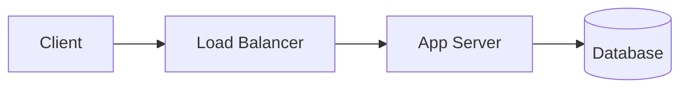

# The basic starting system
Let's start with the most basic three-tier web architecture, and then discuss how it scales and changes under different requirements. 

In this system, the client calls an API, a load balancer spreads those requests across a pool of stateless application servers, and those servers read and write a database that holds the truth.

A few properties are worth keeping as you build on it: 
- The app tier stays stateless so you can add and remove servers freely, 
- Indexes follow the queries the product actually runs, and 
- Writes are idempotent so a retry doesn't create two orders.

What comes next depends entirely on the requirements. 
- Reads that vastly outnumber writes push you toward caching and replicas. 
- Data that outgrows one machine pushes you toward partitioning. 
- Work too slow to finish inside a request pushes it into the background. 

# The patterns 
| Pattern                                                                                                            | Useful when                                         | Key concepts                                              |
| ------------------------------------------------------------------------------------------------------------------ | --------------------------------------------------- | --------------------------------------------------------- |
| [Read-heavy systems](https://www.aced.io/courses/system-design-interviews/read-heavy-systems)                      | Reads vastly outnumber writes                       | Caching, CDNs, read replicas, precomputed read models     |
| [Event-driven and pub/sub](https://www.aced.io/courses/system-design-interviews/event-driven-pubsub)               | One action triggers many independent reactions      | Brokers, topics, delivery semantics, idempotent consumers |
| [Async jobs and workers](https://www.aced.io/courses/system-design-interviews/async-jobs-workers)                  | Work is too slow or unreliable for the request path | Queues, worker pools, leases, retries, dead-letter queues |
| [Distributed storage](https://www.aced.io/courses/system-design-interviews/distributed-storage)                    | Data or write volume outgrows one node              | Partition keys, routing, replication, rebalancing         |
| [Transactional workflows](https://www.aced.io/courses/system-design-interviews/transactional-workflows)            | Users compete for scarce inventory                  | Atomic claims, holds, sagas, idempotency                  |
| [Batch processing and data pipelines](https://www.aced.io/courses/system-design-interviews/batch-data-pipelines)   | The product is analytics or derived data            | Ingestion, buffering, windows, backfills                  |
| [Real-time and collaborative systems](https://www.aced.io/courses/system-design-interviews/realtime-collaborative) | The server must push to the client                  | WebSockets, connection registry, fan-out, presence        |
| [Media streaming and content delivery](https://www.aced.io/courses/system-design-interviews/media-streaming)       | The payload is large media consumed over time       | Transcoding, segments, adaptive bitrate, CDNs             |
| [Agentic AI architectures](https://www.aced.io/courses/system-design-interviews/agentic-ai)                        | A model plans and calls tools in a loop             | Agent loops, tool calling, RAG, guardrails, evals         |
# Combining patterns
Real problems may involve combining two or more of these patterns. Here's an example.

In Design Uber Eats, the ordering path has to be correct above all else, since a double charge is a real-money failure — that's a transactional workflow. Once an order is confirmed, six different services need to know about it, and none of them should be able to block checkout — that's event-driven fan-out. Meanwhile the driver's location dot updates continuously on the customer's screen, which is a real-time system. Three patterns, three different sets of tradeoffs, one question.