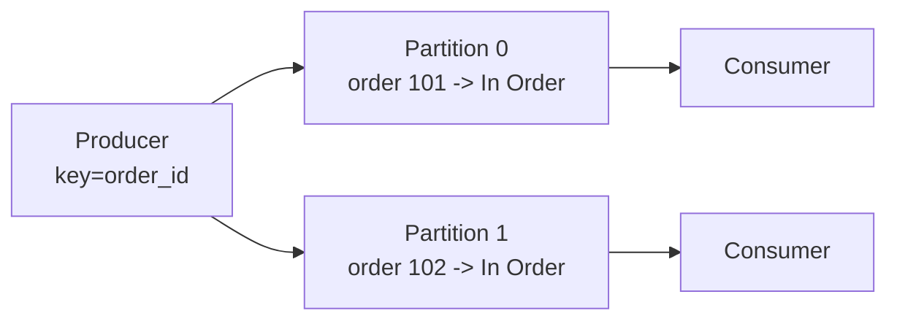

When a customer places an order at a store like Amazon, how do payment, inventory, notifications, and analytics all react without making checkout wait for every service? 
The answer is an **event-driven system**, where a service announces what happened and other services respond independently.

The Order Service publishes an event such as `OrderCreated`, and every subscriber receives its own copy. The publisher does not wait for those services or even need to know they exist.
[18. Messaging Queue & Kafka](../../System%20Design/18.%20Messaging%20Queue%20&%20Kafka.md)
# The core idea
In a synchronous system, Service A calls Service B and waits. This is appropriate for simple request/response flows, but it couples their latency and availability. If B is slow or unavailable, A inherits the problem. As more services join the flow, A must know about every one, and the user's request stays open until the chain finishes.

Event-driven architecture changes that relationship. Service A announces that something happened, and interested services decide how to react.

When a user places an order, the Order Service publishes `OrderCreated`. Payment, inventory, notifications, analytics, fraud detection, and search indexing consume it independently. We can add or change a consumer without editing the Order Service.

# Two distinctions to make early
## Events vs. commands. 
An _event_ is something that already happened: `OrderCreated`, `PaymentCaptured`, `UserSignedUp`. Events are facts. 
A _command_ is something that should happen: `ChargePayment`, `SendEmail`. 

Commands are instructions. Producers in pub/sub systems usually publish events, because they shouldn't dictate what downstream services do. Rather than sending `SendEmailToUser`, the Order Service publishes `OrderCreated` and lets the Notification Service decide whether that means an email, an SMS, a push, or nothing. That separation is what keeps services loosely coupled.

## Queue vs. pub/sub. 
A _queue_ distributes work among workers, and each message is usually processed by exactly one worker. Use it when work should happen once, such as sending one email or transcoding one video. 
_Pub/sub_ broadcasts events to multiple independent subscribers, and each subscriber group gets its own copy. Use it when many systems must react to the same event. 

The rule of thumb: queue when work is processed once, pub/sub when multiple systems react to the same fact. Reliable execution of the work itself is [Async Jobs and Workers](../04.%20Async%20Jobs%20and%20Workers/Async%20Jobs%20and%20Workers.md).

# The dual-write problem and the outbox pattern
Suppose the Order Service creates an order in its database, then crashes before publishing `OrderCreated`. The database says the order exists, but no downstream service will hear about it. This is the **dual-write problem**: the service writes to the database and broker without one shared transaction, so the two systems can diverge.

The **outbox pattern** solves it. The service writes the business record and an outbox event row in the same database transaction, and a background publisher reads that table and publishes to the broker.

Because the order and outbox row commit atomically, the event cannot be lost or describe an order that never existed. This gives us reliable publishing without a distributed transaction.
# Delivery semantics and idempotency

We need to choose a delivery guarantee. **At-most-once** means a message may be lost but is never repeated. **At-least-once** means the message is retried until acknowledged, so it may arrive more than once. At-least-once is the common production model.

True exactly-once _delivery_ is generally considered impossible in a distributed system. The network can fail after processing but before acknowledgment, which forces a redelivery. What systems can provide is exactly-once _processing_, sometimes called effectively-once: at-least-once delivery combined with idempotent consumers and deduplication. A broker's guarantee alone does not protect an external database write or payment call.

Since most systems deliver at least once, **consumers must be idempotent**. If the same `OrderCreated` event arrives twice, the Notification Service shouldn't send two emails and the Payment Service definitely shouldn't charge twice. Common techniques include idempotency keys, deduplication tables, unique constraints, event IDs, consumer offsets, and already-processed checks. Stripe's write-up on [idempotency keys](https://stripe.com/blog/idempotency) shows how this works in a real payments API.

# Ordering and partitioning
Some workflows only make sense in order. `OrderCreated → PaymentCaptured → OrderShipped → OrderDelivered` is meaningless shuffled, and out-of-order delivery can make consumers behave incorrectly.

Kafka-style systems preserve order within a partition, so the partition key is the design decision. Partition by `order_id` for order events, or by `user_id` for user activity. That guarantees ordering for a single entity rather than globally, which is usually the right trade-off.

Partitioning by order_id keeps each order's events in order while still spreading load. Order holds within a partition, not globally.

A poor partition key fails in one of two ways. Partition randomly and you lose the per-entity ordering you needed. Partition too narrowly, around one celebrity user or one giant tenant, and you create a hot partition that bottlenecks the whole topic.

# Failure handling
Failures are normal in async systems. A consumer can fail because a downstream database is unavailable, a payload is malformed, a dependency times out, or a deploy introduced a bug. A production-grade design includes retries for transient failures, exponential backoff so a broken dependency isn't hammered, **dead-letter queues (DLQs)** for messages that repeatedly fail, alerts when failure rates cross thresholds, replay tools to reprocess events after a fix, and consumer offsets to track progress.

Define what happens _when processing fails_, not only how messages are sent. [Async Jobs and Workers](../04.%20Async%20Jobs%20and%20Workers/Async%20Jobs%20and%20Workers.md) covers error classification, backoff budgets, and DLQ replay in detail.
# Common pitfalls
- **Publishing before the transaction commits.** Consumers react to something that never happened. This is exactly what the outbox prevents.
- **Assuming exactly-once processing.** Most systems deliver at least once, so consumers have to be idempotent.
- **No plan for poison messages.** One malformed message can fail forever and block everything behind it without a dead-letter queue or a skip policy.
- **Bad partition keys.** These either cost you the ordering you partitioned for, or create hot spots.
- **Unversioned events.** Any schema change breaks consumers you haven't redeployed.
