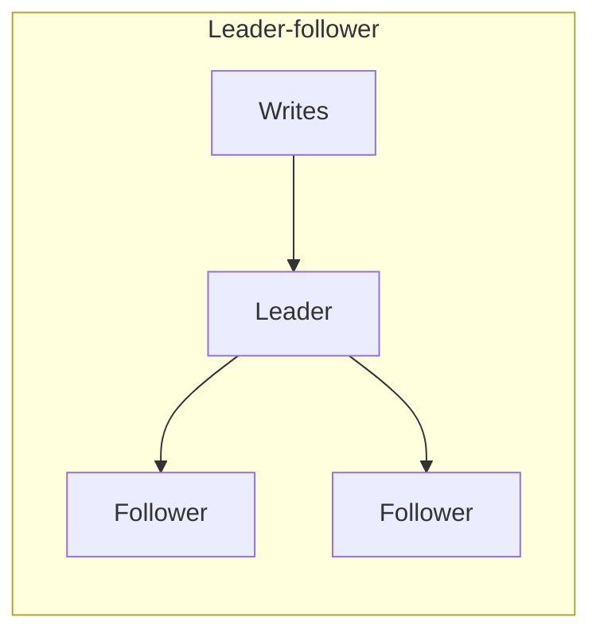
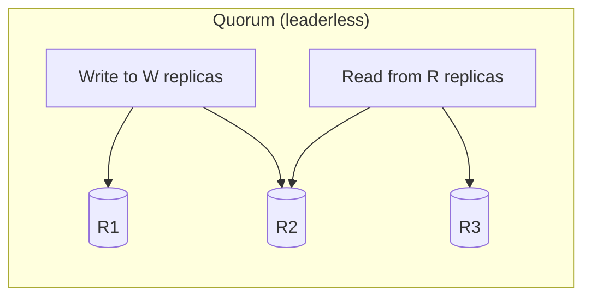

When a dataset becomes too large or write-heavy for one machine, how do we add capacity without replacing that machine with an even bigger one? A **distributed storage system** partitions the data across many nodes, with each node owning a slice.

Distribution gives us storage and write throughput, but makes cross-key queries, multi-key transactions, and operations more expensive.

[Sharding](../../System%20Design/09.%20High%20Level%20Design.md#Sharding)

# The core idea
A single node has three hard ceilings: storage (disks fill up), write throughput (one primary absorbs only so many writes per second), and memory (the working set stops fitting in RAM).

Instead of storing everything on every node, choose a **partition key** and store each record on the node responsible for that key. Then solve four connected problems: splitting the data, routing requests, replicating each partition, and moving data as nodes join or leave.

# Partitioning strategies
**Range partitioning** splits ordered keys into contiguous ranges. Range scans are cheap ("all orders for March"), which is why HBase, Bigtable, and most time-series stores use it. The danger is skew: partition by timestamp and all new writes land on the last range, one hot node no matter how many you have.

**Hash partitioning** spreads load evenly by hashing the key, at the cost of range scans, since adjacent keys land on different nodes. This is the default for key-value workloads.

**[Consistence Hashing](../../System%20Design/10.%20Consistence%20Hashing.md)** fixes the resizing trap. Plain `hash(key) mod N` remaps almost every key when N changes. Consistent hashing places nodes and keys on a ring so adding or removing a node moves only about 1/N of the keys, and virtual nodes smooth out load imbalance.

**Directory-based partitioning** maps key to partition through an explicit lookup service. Maximum flexibility (move any tenant anywhere), at the cost of the directory becoming a critical dependency that itself must be cached, replicated, and kept consistent.

A useful hybrid is a **compound key**. Hash one component to spread load, then range-sort another component within the partition. Cassandra's partition key and clustering key follow this model: hash `user_id` to choose the node, then sort by timestamp so "recent messages for user X" is one sequential read.

# Routing and replication
Requests can find their partition through a **routing tier**, **smart clients**, or **any-node coordination**.
- A routing tier keeps clients simple but adds a hop. 
- Smart clients cache the partition map and handle "moved" redirects. 
- With any-node coordination, nodes share ring state through gossip and forward requests internally.

Partitioning alone makes reliability worse: more machines fail more often, and now each failure loses unique data. So every partition is replicated, under one of two dominant models.

**Leader-follower per partition.** One leader takes writes, and followers replicate them. On failover, detect the leader's failure, elect a replacement with Raft, Paxos, or an external coordinator, and fence the old leader so it cannot keep accepting writes during a network partition. Kafka partitions and most sharded SQL systems use this model.

**Leaderless quorum.** Any replica accepts writes; with N replicas, W write-acks and R read-acks, W + R > N guarantees overlap so reads see the latest write. Tunable per request, but requires conflict handling (last-write-wins with its silent-data-loss caveat, or version vectors) plus read repair and hinted handoff. The Dynamo/Cassandra lineage.

# Rebalancing and hot partitions
Capacity will change, so rebalancing is part of the normal design.
One approach creates far more partitions than nodes up front, such as 1,024 partitions across 16 nodes. Adding a node then moves whole partitions without changing their key boundaries.
Other options include splitting partitions when they cross a size threshold or using consistent hashing with virtual nodes. During a live migration, copy the partition while it serves traffic, apply ongoing writes to the copy, switch routing, and then remove the old copy. Throttle migration traffic so it does not starve production requests.

Even a perfect hash cannot spread traffic for one extremely popular key. A celebrity account, viral post, or large tenant can still overload one partition. We can choose a higher-cardinality key, **salt the hot key** into `key#1..key#k` subkeys, move a large tenant onto dedicated capacity, or cache read-hot keys. Salting spreads writes but makes readers gather the value from several partitions. If we partition by `video_id`, for example, a viral video's view-count writes may need this treatment.

# Tradeoffs and considerations
Once data lives on more than one node, a set of operations that used to be free stop being free:

- **Secondary indexes** come in two flavors. A _local_ index keeps writes inside one partition, but queries have to scatter-gather across every partition. A _global_ index sends queries to one place, but every write touches two partitions and the index is usually eventually consistent. Say which one you're choosing.
- **Joins and multi-key transactions** across partitions require moving data or coordinating with two-phase commit or a saga ([transactional workflows](https://www.aced.io/courses/system-design-interviews/transactional-workflows)). Choose a partition key that keeps common transactions local. In a booking system, partitioning by `event_id` keeps all seat holds for one concert together.
- **Aggregations** turn into scatter-gather queries or precomputed pipelines ([batch data pipelines](https://www.aced.io/courses/system-design-interviews/batch-data-pipelines)).
- **Not every large dataset needs this at all.** Blobs, media, and backups belong in [object storage](https://www.tryexponent.com/courses/system-design-interviews/object-storage), which handles distribution for you.

# When to use it, and when not to

Reach for partitioning when the dataset can't fit (or won't soon fit) on one node's disk or RAM working set, when write throughput exceeds what a single primary can absorb, when you're designing a storage component itself (key-value store, message queue, object store, time-series database), or when tenant isolation or data residency forces data to live in specific places.

Do not shard prematurely. A well-indexed Postgres database with replicas can support many systems. Sharding adds routing, rebalancing, replication, and cross-partition coordination, so it needs a concrete capacity or isolation requirement. Read-heavy workloads on modest datasets need the read-heavy pattern. Analytics with joins across the whole dataset need a warehouse and batch pipeline rather than a sharded OLTP store.

# Common pitfalls

- **`hash(key) mod N` routing.** Changing N remaps nearly every key, and capacity changes are a certainty.
- **No answer for adding a node.** "We shard by user_id across 8 nodes" needs a story for node 9.
- **Casual cross-shard transactions.** "Then we update both shards" skips the coordination and failure handling the operation requires.
- **Leader replication without fencing.** A partitioned old leader keeps accepting writes and silently diverges.
- **Three replicas in one rack.** Spread replicas across failure domains, and say that you're doing it.