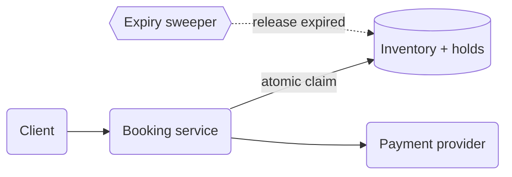
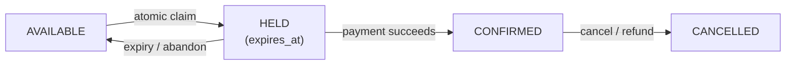

When ten thousand people try to buy the same concert seat at once, how does a service like Ticketmaster ensure that one person gets it and pays exactly once? The answer is a **transactional workflow**, which claims scarce inventory atomically and protects that claim while slower steps such as payment finish.

The system must prevent double-selling, avoid charging for an order it cannot fulfill, and release inventory when checkout is abandoned. We can handle those failures with hold-then-confirm: create a short-lived reservation atomically, take payment while the hold protects the inventory, then confirm the purchase or release the hold. The design needs a clear atomicity boundary, an expiry policy, and a consistent destination for every failure path.


The booking service claims inventory atomically before charging anyone, an external payment provider runs while the hold protects the seat, and a sweeper reclaims holds that expire.
# The core idea
The browsing path may use caching, replicas, and eventual consistency from [Read Heavy System](../02.%20Read%20Heavy%20System/01.%20Read%20Heavy%20System.md). The claim path cannot rely on a stale inventory count because two buyers may both see the last seat as available.

The failure we're defending against is a **race condition**: two requests interleave in time and produce a result that neither would produce on its own. The specific form here is **read-check-write**. Request A reads "seat available," request B reads "seat available," both pass the check, and both write "sold." Neither request is wrong in isolation. The bug exists only because they overlapped.

Any design that checks availability in one step and claims it in another, with no concurrency control in between, has this race. The fix is to collapse the check and the claim into a single step that can't be interleaved, then build the rest of the workflow around it.

The **hold** bridges the gap between an atomic claim and a slow payment. If we wait until after payment to claim the seat, another buyer can take it during checkout. If we mark it sold before payment, abandoned checkouts strand inventory. A hold claims the seat temporarily and gives the slower steps a deadline.

# The reservation state machine
Model each unit of inventory as a **state machine** in the database: a stored state with a defined set of valid transitions. A failed payment or abandoned browser lets the hold expire back to `AVAILABLE`. If two services disagree about whether a seat is sold, the database row remains the source of truth.

A seat moves through four states. Pay particular attention to transitions back to `AVAILABLE`, because they prevent abandoned checkouts from freezing inventory.


Every unit of inventory moves through explicit states. The edges back to AVAILABLE are what stop abandoned checkouts from stranding inventory forever.

Clarify three design points:

- **Hold duration**: long enough to complete payment (5 to 10 minutes for tickets), short enough that abandoned carts don't strangle inventory, extendable while the user is actively checking out.
- **Expiry mechanism**: a background sweeper cleans up old holds, but availability queries should also apply lazy expiry and treat a hold as invalid when `expires_at < now()`. Correctness then does not depend on the sweeper running on time.
- **Who owns the count**: for unit inventory (specific seats), hold rows per unit; for counted inventory (100 general-admission tickets), a conditional decrement with a check on the affected-row count:
```SQL
UPDATE inventory SET available = available - 1
WHERE id = ? AND available > 0;
```

# Making check-and-claim atomic
**Atomic** means the check and the claim happen as one indivisible step: either the whole operation takes effect or none of it does, and no other request can observe or act on the seat in between. That property is what closes the race.

There are three common ways to make the claim atomic:

- **Atomic conditional writes.** Start with one statement that checks and claims at once, such as the conditional `UPDATE` above, a DynamoDB conditional put, or a Redis Lua script. The datastore serializes competing writes, so the application does not need an explicit lock.
- **Optimistic concurrency.** Read a version number, then write back with `WHERE version = ?`, and retry if the row changed underneath you. Good at low-to-moderate contention when you genuinely need to read, decide, then write. It's the wrong choice for the hottest rows in a big on-sale, where the retries pile into a storm.
- **Pessimistic locking.** `SELECT ... FOR UPDATE`, decide, commit. Fine at moderate contention. Always lock rows in a consistent order to avoid deadlocks, and never hold a lock across an external call.

Whatever mechanism you choose, add `UNIQUE(event_id, seat_id)` to confirmed bookings. The database constraint remains a final defense if application logic is wrong.

Distributed locks (the Redis-style kind) come up often and are weaker than they look. 
A lock with a TTL can expire while its holder is merely stalled, quietly admitting a second holder who believes they hold it exclusively. When the data lives in one database, its own conditional write is both simpler and safer.

# Stitching in payment: sagas, not distributed transactions
The workflow also needs four protections:

- **Idempotency everywhere.** The user double-clicks, your payment call times out and retries, the provider's webhook arrives twice. Every step has to be safe to repeat: idempotency keys on the charge, upsert-style confirmation keyed by reservation ID, and deduplication on webhook event IDs.
- **The ambiguous timeout.** A payment call that times out may still have succeeded. Query the provider by idempotency key, or wait for its webhook, before deciding what happened. Make the hold long enough to cover that resolution window.
- **Reliable state transitions.** Confirming the booking and publishing a `BookingConfirmed` event must not diverge, which is the outbox pattern from [Event-Driven and Pub-Sub Architectures](../03.%20Event-Driven%20and%20Pub-Sub%20Architectures/Event-Driven%20and%20Pub-Sub%20Architectures.md).
- **Crash recovery.** If the orchestrating service dies between steps, something has to resume or unwind the workflow. Keep a durable row per order holding its saga state, advanced by idempotent steps, so one place owns the order's state machine. Engines like Temporal or Step Functions do this for you.

# Surviving the rush
A stadium on-sale concentrates a burst of traffic onto a few thousand rows. Combine four defenses:

- **A virtual waiting room** admits users into checkout at a controlled rate. This converts an overload problem into a fairness problem, which is a much better problem to have.
- **Serve the seat map from cache, but decide at the source of truth.** The map thousands of people are staring at can be a few seconds stale, while the claim is always an atomic write against the authoritative store. Push seat-taken updates to viewers asynchronously ([Real-Time and Collaborative Systems](../08.%20Real-Time%20and%20Collaborative%20Systems/Real-Time%20and%20Collaborative%20Systems.md)).
- **Partition by event** ([Partitioned and Distributed Storage](../05.%20Partitioned%20and%20Distributed%20Storage/Partitioned%20and%20Distributed%20Storage.md)) so one on-sale can't take down the rest of the platform, and each claim stays inside a single partition.
- **Prefer counted inventory where the product allows it.** General-admission tickets are one shardable counter; reserved seating spreads contention across seat rows naturally.
### Overselling on purpose

Not every domain forbids overselling. Airlines and hotels may overbook against predicted no-shows, while e-commerce may accept occasional oversells rather than reject a purchase. If the business relaxes the invariant, represent that as an explicit overbooking budget with reconciliation and compensation such as rebooking, refunds, or vouchers. Clarify whether overselling is forbidden, as with an assigned seat, or allowed as a deliberate policy.
# Common pitfalls

- **Checking availability against a cache or replica.** The check has to happen atomically with the claim, against the source of truth.
- **Reading and then writing in two separate statements.** Another request can change the inventory between the check and the claim.
- **Holds that never expire.** Abandoned carts freeze inventory that nobody can buy.
- **Treating a payment timeout as a failure.** The charge may have succeeded, so a blind retry double-charges.
- **Confirmation that isn't idempotent.** A duplicate webhook becomes a duplicate booking.