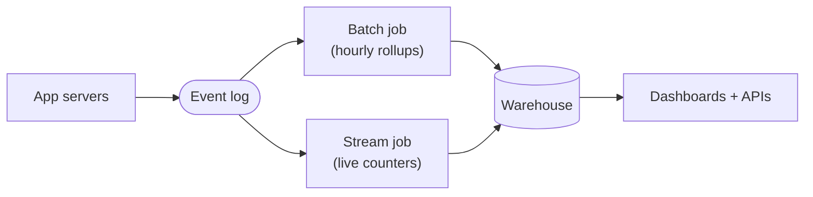

Your product generates billions of clicks, orders, page views, and errors each day. How do systems like Datadog or a large analytics platform turn those raw events into useful dashboards, metrics, and models? The answer is a **data pipeline**, a system that produces derived data rather than a response to one user request.

Most pipelines follow the same stages: ingest, buffer, process, store, and serve. 

We still need to choose how quickly each consumer needs its result. 
- Batch processing handles bounded chunks at high throughput with minutes or hours of latency. 
- Stream processing handles an unbounded flow continuously and can produce results within seconds, but it is harder to operate correctly. 

Good pipelines use replayable stages, distinguish event time from processing time, support backfills, and avoid paying for streaming where a scheduled batch is enough.

