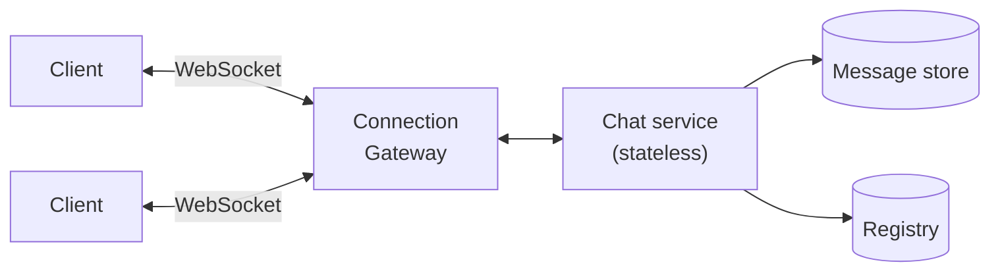
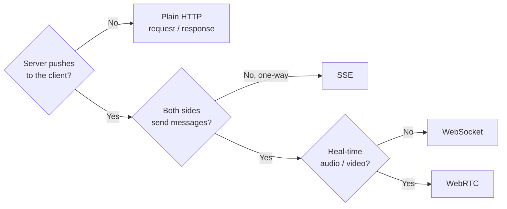
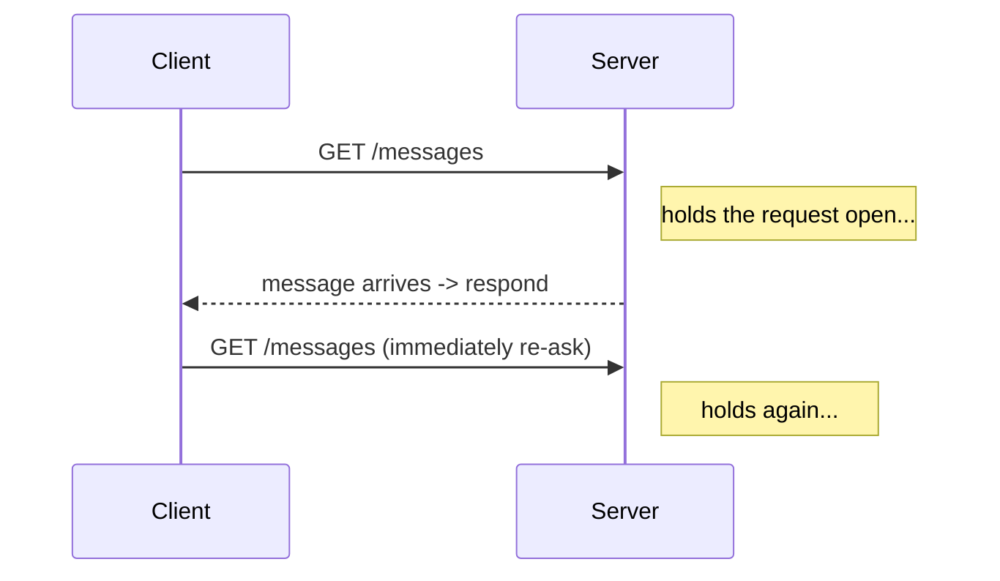
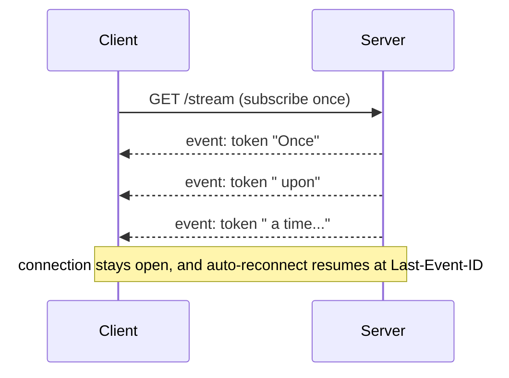
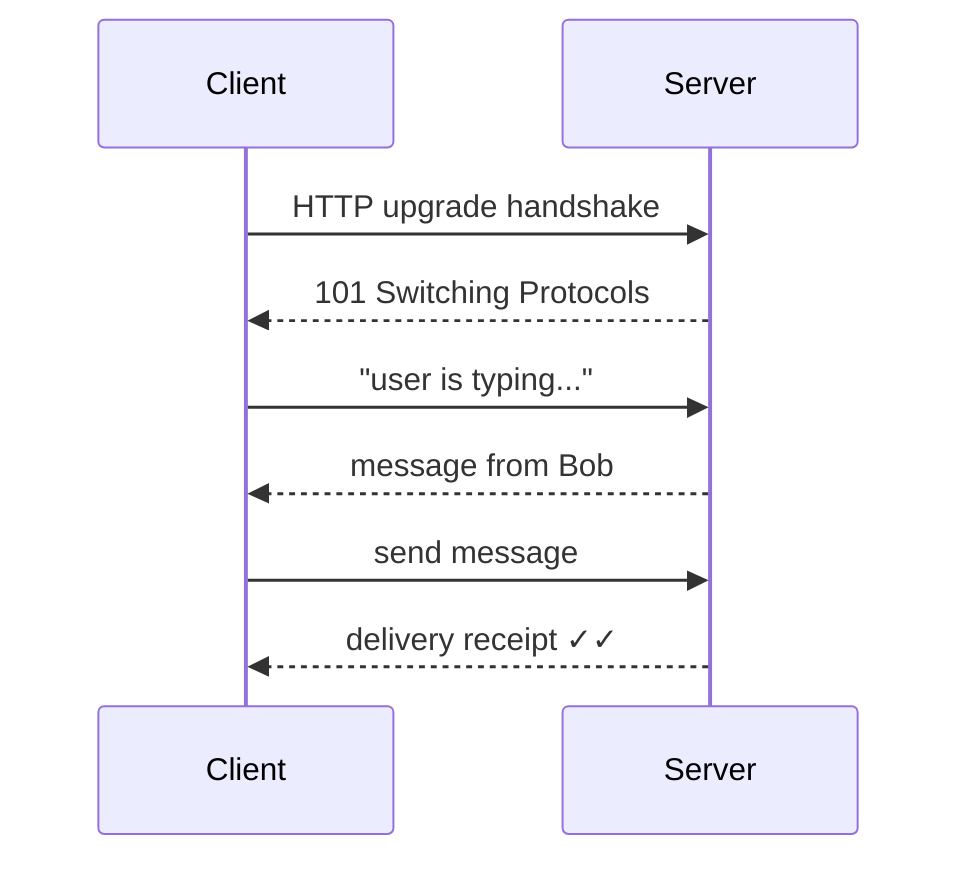
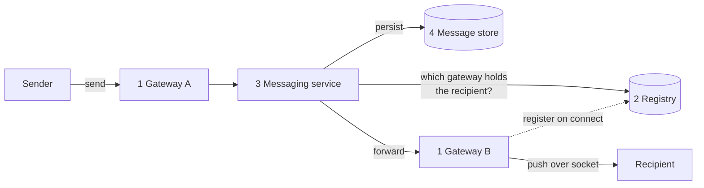
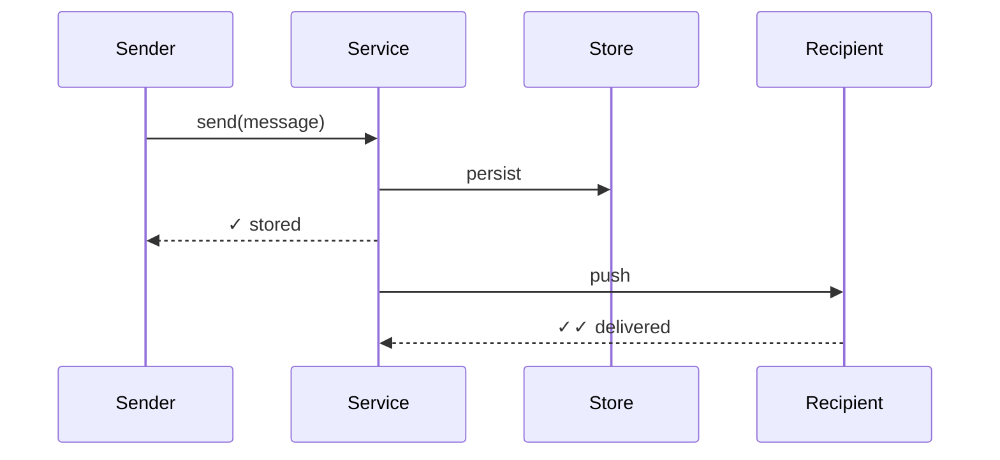
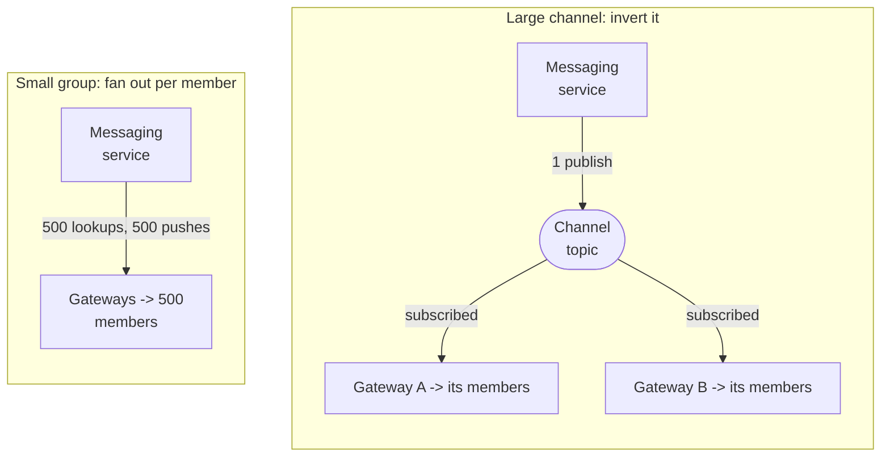

Someone sends a message in Slack, and it appears on a teammate's screen a few hundred milliseconds later without the client polling for it. How does the server find the right device and deliver the message that quickly? A **real-time system** keeps a connection open so the server can push new information as soon as it arrives.

Most web requests are short-lived: the client asks, the server answers, and the connection closes. Real-time systems keep connections alive for minutes or hours, which makes the connection tier stateful. We need a registry that tracks where each user is connected, a persist-then-push delivery path, and a way to resume after dropped connections. Collaborative products also need ordering and conflict rules when users act at the same time.

# The core idea
Real-time architecture keeps a connection open so either side can send immediately. That persistent connection creates the routing, recovery, and capacity problems in this pattern.

A persistent connection is state. A stateless load balancer can send an HTTP request to any server because the request is self-contained. A WebSocket lives on one machine for minutes or hours, so every message for that user must find its way back to that machine. The rest of the architecture manages that connection state.

# Choosing a transport
Choose the transport from the interaction rather than defaulting to WebSockets. 

Two questions narrow the choice: 
- Does the server need to push data?
- Do both sides need to send?

SSE and WebSockets cover most real-time application traffic, with long-polling as a fallback when neither is available.

**Long-polling** fakes push over plain HTTP. The client sends a request, the server holds it open until it has data (or times out), responds, and the client immediately asks again. Every message costs a full request cycle, which is why it's the fallback rather than the plan.

**Server-Sent Events (SSE)** turn one HTTP response into a long-lived stream. The client subscribes once and the server writes events down the open response as they happen. Reconnect and resume (`Last-Event-ID`) are built into the protocol. This is exactly how ChatGPT-style token streaming works: one request out, thousands of tokens streaming back.

**WebSockets** upgrade the connection to full-duplex: after one handshake, either side sends at any time with minimal per-message overhead. This is the default for chat, multiplayer games, and collaborative editing, where the client sends as often as the server does.

# The connection tier
Because a connection is state, the architecture grows a tier that doesn't exist in a stateless CRUD service: a fleet of **gateway** servers whose only job is to hold sockets. Everything else hangs off this tier.

Components

1. **Gateway fleet.** Holds the open sockets, and nothing else.
2. **Connection registry.** Maps `user_id → gateway(s)`, so the system knows where to push.
3. **Messaging service.** The business logic, which validates, persists, then delivers.
4. **Message store.** Durable history and the source of truth.

**Gateways are simple, dense, and restartable.**
- Each node holds roughly 100k to 1M connections, so memory per connection determines capacity. 
- A gateway authenticates clients, sends heartbeats, and moves bytes in both directions. 
- Since sender and recipient are rarely on the same gateway, each gateway registers its connections and removes them on disconnect.
- TTLs and heartbeats allow stale entries from a crashed gateway to expire. 
- The messaging service can then route to one recipient's gateway instead of broadcasting across the fleet.

**Keep business logic out of gateways.** 
- A gateway holding half a million sockets has a large blast radius. 
- Put application logic in stateless services behind it so a feature deploy does not drop those connections.
- A gateway restart should require clients to reconnect, not interrupt stored messages or business state.

**Balance long-lived connections carefully.** 
- WebSockets need an L4/TCP-aware balancer, and you distribute by least-connections rather than round-robin, because connections are long-lived and any imbalance persists for hours. 
- Plan draining explicitly: on deploy, a gateway stops accepting new connections, tells its clients to reconnect elsewhere, and lets its registry entries migrate. A restart should be a non-event.

**Heartbeat to detect dead connections.** 
- TCP can report a connection as open after the peer disappears. 
- The gateway can ping every 30 seconds or so and, after several misses, close the connection, clean the registry, and update presence. Routing and presence both depend on this cleanup.

# The message path: persist, then push
Persist each message before pushing it. A message displayed but never stored disappears when the recipient reloads or reconnects. Storage is the source of truth, while live delivery is a faster path on top of it.

The two acks map to the checkmarks users recognize. 
- The first (one check) means the system stored the message
- The second (double check) means the recipient's device confirmed receipt. 
If the second ack never comes because the connection dropped mid-push, you retry and fall back on the reconnect sync below. When the recipient is offline, nothing is pushed. The message waits in storage, and a push notification (APNs/FCM) wakes the device. Durable storage plus reconnect sync is the offline story, so there's no separate "offline queue" to design.
# Reconnect and resume
Networks drop constantly: a subway tunnel, a Wi-Fi handoff, a closed laptop. The mechanism that makes this survivable is a **cursor**: the client remembers the last sequence number (or timestamp) it has seen per conversation. On reconnect it asks for everything after cursor X, the server replays from storage, and the client dedups any overlap.

The cursor recovers messages that arrived while the client was offline, messages missed during a network blip, and messages whose delivery acknowledgment was lost. The client should deduplicate any overlap between its local state and the replay.
# Ordering and fan-out
## Ordering: per conversation, not global
Global ordering across the whole system is neither achievable nor needed. 
So promise **per-conversation ordering**: assign a monotonic sequence number per conversation, and have clients render by that sequence rather than by arrival time. Two near-simultaneous sends race for the next slot, and whichever wins is fine, because what matters is that every viewer sees the same order.
## Fan-out: one message, many recipients
Delivering to a single recipient generalizes badly. The cost that matters is how much work the messaging service does for one message, and that's what forces a threshold decision.

Below the threshold the service does the work per member; above it, the service publishes once and each gateway delivers to the members it already holds.

For a 500-person group, 500 registry lookups and 500 pushes per message is fine. For a 100k-member Slack channel or a live-stream chat it isn't, because one message becomes 100k pushes originating from a single service.

Invert the fan-out for large channels. Instead of the service looking up every member, each **gateway** subscribes to the channel topic once and delivers to members connected through that gateway. The service publishes one message regardless of channel size, and the gateway fleet shares the delivery work. Use a configurable membership threshold to switch between direct fan-out for small groups and gateway subscriptions for large ones.
# Collaborative editing: why last-write-wins fails
Chat delivers whole messages. Collaborative editing has to merge concurrent changes to the same object. Two people type into the same paragraph at the same moment, and last-write-wins silently destroys one person's work. Two families of solutions handle this.

**Operational Transformation (OT).** A central server sequences operations, and each incoming operation is transformed against the concurrent operations already applied. "Insert at position 5" becomes "insert at position 7" once someone else's earlier insert shifts the text. Ordering and transformation stay local to the server. This is the classic Google Docs approach.

**CRDTs (Conflict-free Replicated Data Types).** Data structures whose operations commute, so replicas apply operations in any order and provably converge, with no central sequencer. CRDTs win for offline-first and peer-to-peer editing, at the cost of more complex data structures and metadata overhead.
### Taming presence and ephemeral signals
Presence, including "online," "last seen," and typing indicators, can generate substantial fan-out if every state change is pushed to every observer. Keep it inexpensive with three techniques:

- **TTL-based presence from heartbeats.** You already heartbeat for connection health, so derive "online" from a fresh heartbeat and "offline" from an expired TTL. No explicit "went offline" event is needed.
- **Debounce transitions.** Flip to "offline" only after 30 seconds of quiet, so a brief blip doesn't spray a flicker of updates to everyone watching.
- **Lazy pull.** Fetch a contact's presence when a chat opens rather than pushing every change to every observer.

Treat typing indicators and read receipts as ephemeral by design: best-effort, not persisted, not retried, and fine to drop. Spending durability on a typing indicator is effort in the wrong place.
# A practical design sequence
1. Establish the interaction, then pick the transport (SSE for one-way, WebSocket for bidirectional, WebRTC for media).
2. Introduce the gateway tier and the connection registry, with TTL and heartbeat cleanup.
3. Walk the message path: persist, then push, with double-check acks.
4. Handle drops with cursor-based reconnect sync, and specify jittered reconnection.
5. Promise per-conversation ordering via sequence numbers.
6. Scale fan-out: per-member below a threshold, channel-subscription inversion above it.
7. Tame presence (TTL, debounce, lazy pull); mark typing and receipts ephemeral.
8. For collaboration, explain why LWW fails and choose OT vs. CRDT vs. single-authority deliberately.
# Common pitfalls

- **Reaching for WebSockets by reflex.** First establish whether the interaction is bidirectional.
- **Treating the connection tier as stateless.** If any gateway could serve any user, you wouldn't need this pattern.
- **Pushing before persisting.** The message is lost the moment the recipient reconnects.
- **Per-recipient fan-out at large scale.** One message in a 100k-member channel becomes 100k pushes from a single service.
- **Last-write-wins on concurrent edits.** It silently destroys one person's work
