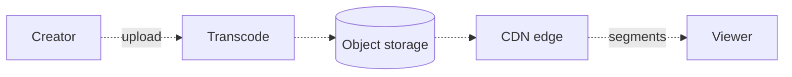
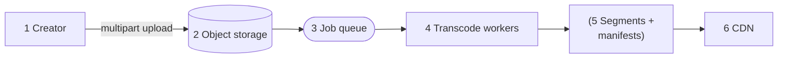

When millions of people press play on the same show, how do services like Netflix or YouTube deliver terabits of video efficiently and cost-effectively? The answer is **media streaming**: a delivery pipeline that turns one uploaded file into many small segments and serves them from the edge.

A single video can be many gigabytes, and each view consumes sustained bandwidth for minutes or hours. Let's split the system into two planes: a small **control plane** for titles, users, and watch history, and a **data plane** that moves video through upload, transcoding, storage, and the CDN.

# The core idea
A movie at streaming quality is 3 to 10 GB, and one viewer may consume about 5 Mbps for two hours. Sending that traffic through application servers would require the fleet of a small ISP. 
The **control plane** holds users, titles, watch history, comments, search, and recommendations. This is small, structured data served through familiar CRUD and read-heavy techniques. 
The **data plane** holds immutable media in object storage and moves it to players through the CDN. Application servers issue signed URLs, but the player downloads video directly from the CDN. Keep each design decision in the plane where it belongs.

Next, divide each video into small **segments**, usually 2 to 10 seconds long. Encode those segments at several quality levels and describe them in a **manifest**. This lets us transcode chunks in parallel, cache small objects at the edge, seek without downloading the whole file, and switch quality while a video plays. The same structure also supports live streaming.

# The VOD pipeline

Stages

1. **Upload.** Large uploads over consumer connections can fail partway through. Make them resumable and chunked, as in S3 multipart upload, and send each part directly to object storage through a presigned URL. The bytes never pass through the API tier.
2. **Raw storage.** Keep the uploaded original as the archival source of truth. When the upload completes, publish an event to start processing.
3. **Job queue.** Treat transcoding as a parallel job system. Split the source at keyframes, fan the chunks out to workers, and retry only the chunks that fail.
4. **Transcode workers.** Produce a rendition ladder with resolutions from 240p to 4K and codecs ranging from widely supported H.264 to AV1, which is 30-50% smaller. Separate GPU and CPU pools, and give creators waiting to publish a higher-priority lane.
5. **Package.** Create the segments and HLS or DASH manifests. A master manifest lists the ladder, and each rendition lists its segment URLs. Premium content may also require DRM around the segments.
6. **CDN.** Serve almost all bytes from edge caches. Storage tiers keep popular titles fast without paying the same cost for the long tail.

# Adaptive bitrate streaming
The player, not the server, chooses the quality. It measures throughput and buffer depth before fetching each segment. If the network slows down, it can drop to 480p and keep playing. When the connection recovers, it moves back up the ladder.

This keeps the server side simple: it delivers static segments over HTTP and holds no per-viewer playback state. Those segments cache well, which is why the design scales. Track startup time and rebuffer rate rather than treating maximum resolution as the main success metric. We also need to choose the bitrate ladder carefully. More rungs produce smoother adaptation, but every additional rendition costs storage and encoding time.

# Delivering from the CDN
Live streaming uses the same broad pipeline as video on demand, but the content is produced while people watch it. We cannot encode and place it ahead of time.

That changes three parts of the design.

**Ingest and transcoding become stateful.** With VOD, any worker can process any chunk of a completed file. A live broadcast arrives as one continuous stream, so its ingest and transcode workers must remain assigned for the duration of the broadcast. Reserve that capacity before the stream begins. This is why platforms like Twitch may produce full quality ladders only for popular channels.

**Segment size becomes the main latency control.** End-to-end delay is usually a few segment durations, so segment length determines how far viewers fall behind the broadcast:

- **6-second segments:** 15 to 30 seconds behind. This may work for a keynote, but not for a match that viewers are also following elsewhere.
- **LL-HLS with chunked transfer:** 2 to 5 seconds, at the cost of more requests.
- **WebRTC:** sub-second, but you forfeit HTTP caching and need an SFU fan-out tier.

**Everyone requests the same segment at once.** VOD traffic is spread across titles and playback positions. During a live broadcast, millions of players may request the newest segment within the same few seconds. Origin shielding and request coalescing are required to absorb that burst. Cache the continuously changing manifest with a short TTL.

### Designing for short-form video formats

**TikTok-style short video** changes the access pattern rather than the pipeline. Startup time dominates the experience, so the player prefetches the first segments of upcoming feed items while the current video plays. A new upload can become popular before the full ladder is ready. Publish a baseline rendition quickly, then fill in the remaining qualities. Ranking becomes the main product system, while this pattern handles delivery.

**Sizing.** Bandwidth is the first number to calculate. 10M concurrent viewers at 5 Mbps require about 50 Tbps, which is far beyond one origin. A CDN is mandatory at that scale. Storage still matters: a 2-hour movie across a full ladder uses 15 to 30 GB, so a million titles require tens of PB before replication. At an egress cost of even $0.01/GB, codec efficiency and cache hit rate directly affect the budget. Spending more on encoding can be worthwhile when it reduces the much larger delivery bill.

# Common pitfalls
- **Streaming bytes through application servers.** The app tier should issue signed URLs without carrying the media itself.
- **Jumping from "upload" to "CDN".** The design still needs a transcoding and packaging pipeline between those stages.
- **Serving a single quality level.** This causes buffering on weak networks and wastes bandwidth on strong ones.
- **Treating live like VOD.** A live design must account for its latency budget and the burst of viewers requesting the newest segment together.
- **Forgetting the control plane.** View counts and watch history are high-write metadata problems that still need their own storage and processing paths.