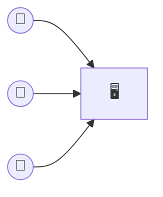
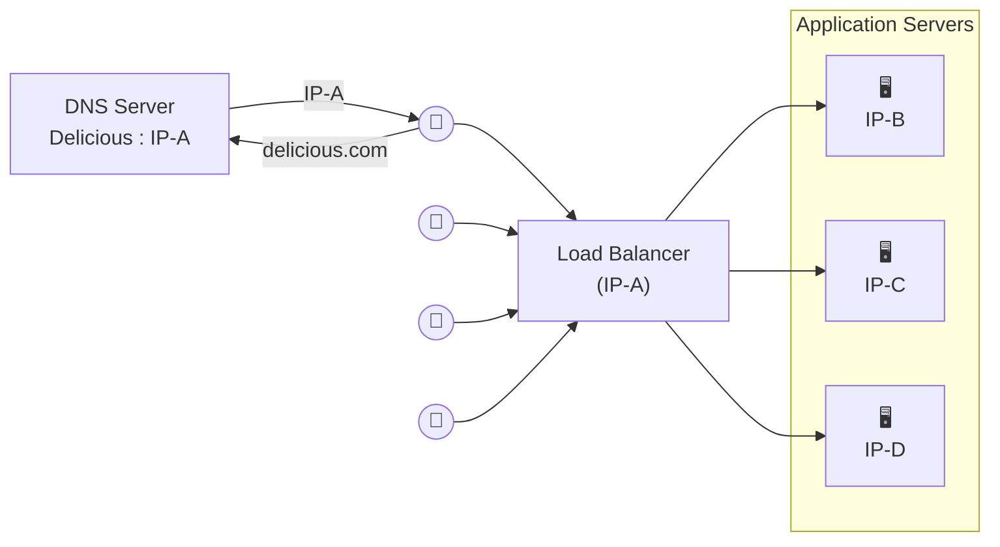

**High Level Design:** Study of how different infra layers work together to serve an application at scale at desired efficiency

# Case Study: Delicious (Website Bookmarking Application 2003)

## Webpages

## APIs 

```
createBookmark(user_id,url)
getBookmark(user_id)
```

## If we run the website on a single server.


### Mermaid dig

### Website can go down because
- Overload
- Hardware failure
- Deploying a new version
## If we run the website on the multiple server


### Mermaid Dig.

