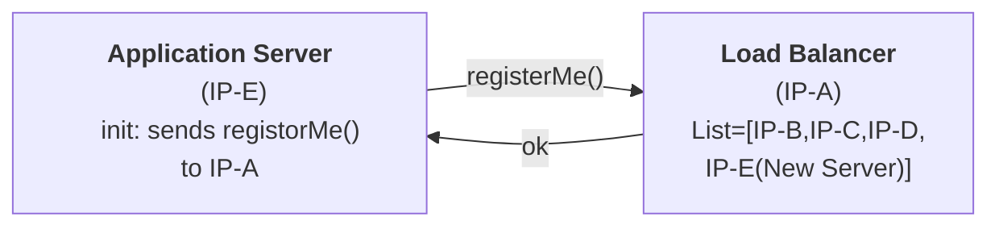

A _load balancer_ is a type of server that distributes incoming web traffic across multiple backend servers.

# 1. How a LB gets to know about an application server?
When an application server starts, it registers itself with LB

# 2. How load balancers work
A good load balancer will efficiently distribute incoming traffic to maximize the system's capacity utilization and minimize the queueing time. Load balancers can distribute traffic using several different strategies:

- Round robin: Servers are assigned in a repeating sequence, so that the next server assigned is guaranteed to be the least recently used.
- Weighted Round Robin: Distributes request in the ratio of the server configuration.
- Least connections: Assigns the server currently handling the fewest number of requests.
- Consistent hashing: Similar to database sharding, the server can be assigned consistently based on IP address or URL.

Depending on the chosen strategy and performance requirements, load balancers can operate at higher or lower network layers (HTTP vs. TCP/IP) or even be implemented in hardware.
# 3.What if server dies?
**How will a LB get to know that a server has died?**
## Heartbeat
- Every server has to send a ping to LB every 't' second
- If the LB doesn't get get a ping from the server for 'nt' second, it'll assume the server is dead
n -> 3,4
## Health Check
- LB will ask server every 't' sec if they are okay
- If the server doesn't respond for 'nt' second, LB will assume that server is dead
# Advantages of load balancers
- **Scalability.** Load balancers make it easier to scale up and down with demand by adding or removing backend servers.
- **Reliability**. Load balancers provide redundancy and can minimize downtime by automatically detecting and replacing unhealthy servers.
- **Performance**. By distributing the workload evenly across servers, load balancers can improve the average response time.
# Considerations
- **Bottlenecks**. As scale increases, load balancers can themselves become a bottleneck or single point of failure, so multiple load balancers must be used to guarantee availability. [DNS round robin](https://en.wikipedia.org/wiki/Round-robin_DNS) can be used to balance traffic across different load balancers.
- **User** **sessions.** The same user's requests can be served from different backends unless the load balancer is configured otherwise. This could be problematic for applications that rely on session data that isn't shared across servers.
- **Longer deploys.** Deploying new server versions can take longer and require more machines since the load balancer needs to roll over traffic to the new servers and drain requests from the old machines.