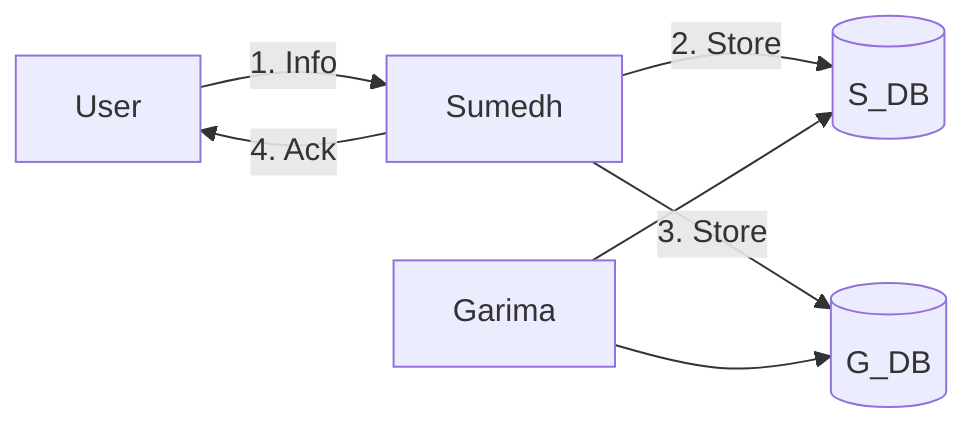
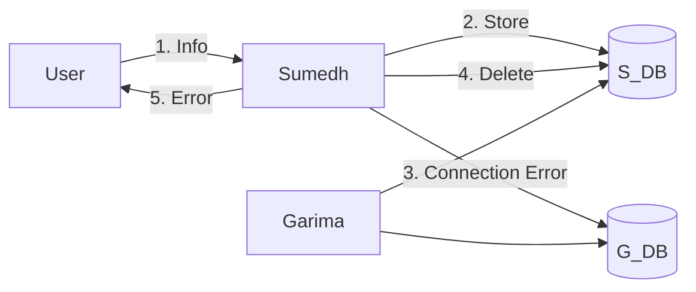
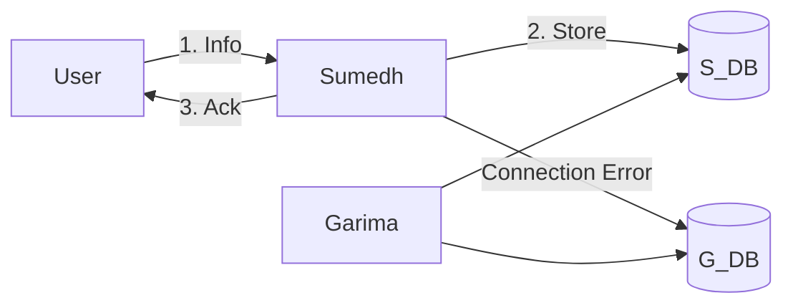

Needs to be considered even before design starts as it dictates how the design should look.
# CAP
Fundamental constraints of distributed system
- C -> Consistency
- A -> Availability
- P -> Partition Tolerance

It states, when a system has partition, the system can either be available or consistent. Never Both.
That is, in a distributed database, you can only ensure consistency or availability in the case of a network partition.
## Partition tolerance
**Partition**
- When software system gets divided such that there is no way to reach from there is no way to reach from one of the machine to other.
- A network partition is a (temporary) network failure between nodes. 

**Partition tolerance**
Partition tolerance means being able to keep the nodes in a distributed database running even when there are network partitions. 

### **Example Scenario**
To better understand the situation with network partitions, we give an example scenario. In a multi-primary architecture, data can be written to multiple nodes. Let’s pretend that there are two nodes in this example database. When a write is sent to Node A, Node A syncs the update with Node B, and any read requests sent to either of the two nodes will return the updated result.

If there is a network partition between Node A and Node B, then updates cannot be synced. Node B wouldn’t know that Node A received an update, and Node A wouldn’t know if Node B received an update. The behavior of either node after receiving a write request depends on whether the database prioritizes consistency or availability.

## Consistency
Consistency is the property that after a write is sent to a database, all read requests sent to any node should return that updated data. In the example scenario where there is a network partition, both Node A and Node B would reject any write requests sent to them. This would ensure that the state of the data on the two nodes are the same. Or else, only Node A would have the updated data, and Node B would have stale data.

## Availability
Availability means that we prioritize nodes to successfully complete requests sent to them. Available databases also tend to have eventual consistency, which means that after some undetermined amount of time when the network partition is resolved, eventually, all nodes will sync with each other to have the same, updated data. In this case, Node A will receive the update first, and after some time, Node B will be updated as well.

## Example
When `User` tells any info to `Sumedh`, `Sumedh` puts it in his DB(`S_DB`) as well as `G_DB` and finally confirm to customer that has noted. 

### When `Sumedh` is unable to reach `G_DB`
$\therefore$ Sumedh's system and Garima's system are now partitioned
#### Option 1
Tell the customer I am unable to do this.

- [x] Consistency
- [~] Available
#### Option 2
Store only in `S_DB` & confirm to customer

- [~] Consistency
- [x] Available
### Consistency & Availability (In reference to the example )
**Consistency**: If it return an answer will be correct BUT many times it may return nothing.

**Availability**: It will return an answer but answer may or may not be correct.
## CAP: A system can only have 2 at a time and not all three
- CA: Never have partitions (Impossible for distributed system)
- AP
- CP
## When should consistency or availability be prioritized?
If you’re working with data that you know needs to be up-to-date, then it may be better to store it in a database that prioritizes consistency over availability. 

On the other hand, if it’s fine that the queried data can be slightly out-of-date, then storing it in an available database may be the better choice.
## Popular databases that prioritize consistency vs. availability

| Prioritize Consistency | Prioritize Availability |
| :--------------------- | :---------------------- |
| SQL Databases          | Cassandra               |
| MongoDB                | AWS DynamoDB            |
| Redis                  | CouchDB                 |
| Google BigTable        |                         |
| HBase                  |                         |
# PACELC

- When system has partitions
	- P -> Partition Tolerance
	- A -> Availability
	- C -> Consistency
- When system have no partitions
	- E -> Else
	- L -> Low Latency
	- C -> Consistency

