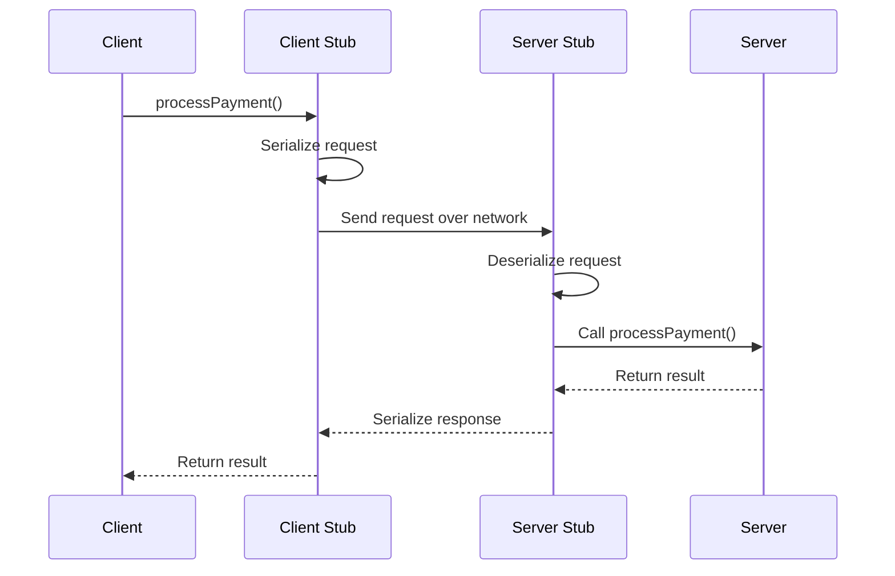
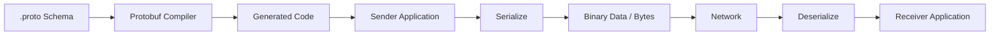
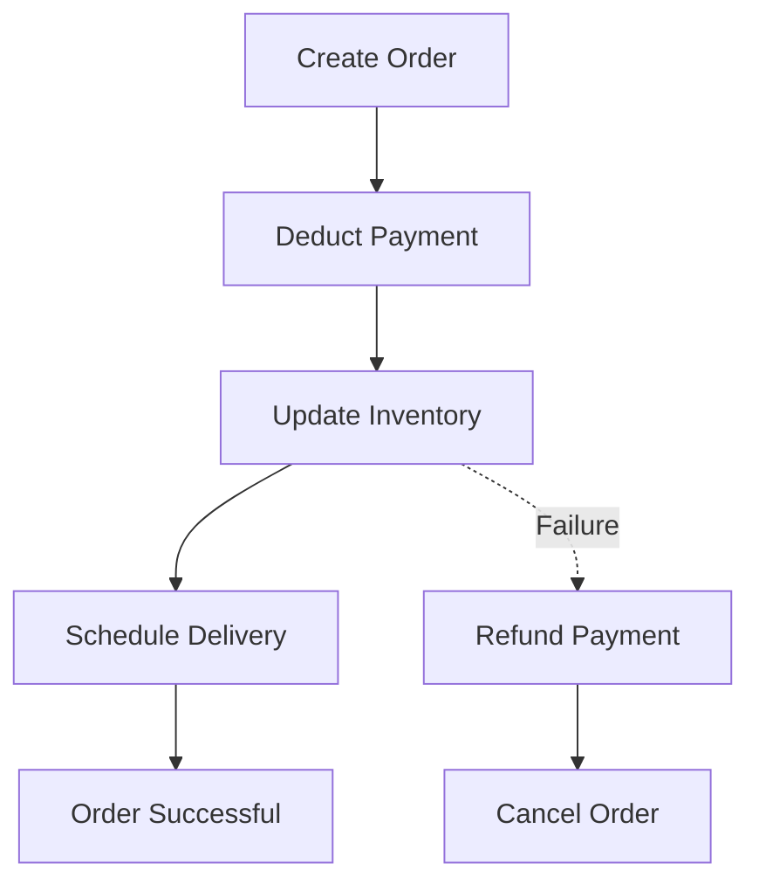
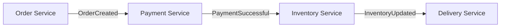
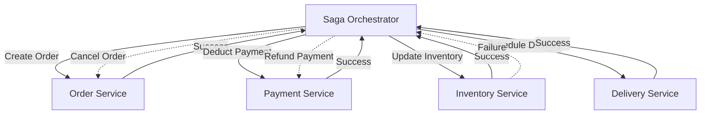
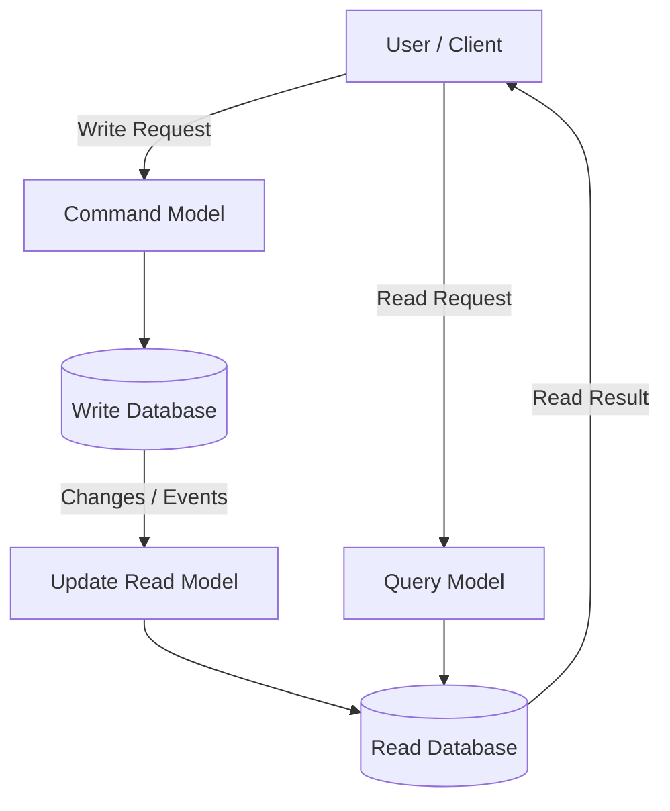

# Monolithic Application
Software system where the complete codebase is part of a single application.

- Codebase have all the function required in it.
	- $\therefore$ All functions are in same server 
```
src/application/
				function1
				function2
				function3
				...
				...
				...
```
- Every machine (Application Server) has complete codebase.
 
- As a company grows, the size of codebase also grows.


## Cons
1. Huge time to compile -> Not productive for devs
2. Dev onboarding is a time taking process
3. An issue in 1 part of codebase may bring other things down
4. Legacy Tech Stack -> Everything have to be in same language
5. No selective scaling
## Pros
 1. Talking to another functionality as simple as talking to another function call
	 - Low overhead
	 - Low latency
 2. Testing everything is easy (Especially Integration testing)
 3. Sharing of knowledge is easy 
	 - No overhead of understanding new codebase
	 - Less work for developers
 4. Lower cost (Sometimes)
# Microservice
When the software is divided into more than one independent application

An ideal microservice works like a completely different company


 **IMP** Distributed system may or may not be MicroServices
## Pros
1. Selective Scaling
2. Each Application is Isolated
3. Easier Onboarding
4. No Legacy Tech Stack
5. Reduced time to compile -> Increased dev productivity
## Cons
1. High cost
	- Deploy each application independently -> More server cost
2. API calls between service 
	 - High overhead
	 - High latency

# API Gateway

Forward request to correct application server based on:
1. Path
2. reqBody
3. Header


Example:
- Kong
- APIGEE
# Service Oriented Architecture (SOA)
- When the codebase is split into different application
- But each application is not completely independent
	- Two application have common Database 


# Communication between MicroService
- Asynchronous
	- Message Queue
- Synchronous -> Directly makes an API call to another service
	- HTTP
	- RPC (Remote Procedure Call)

## RPC (Remote Procedure Call)

- A communication mechanism that allows one application to call a function/method present in another application, as if it were a local function call.    
- Used for **Synchronous communication** between Microservices.
### How RPC works

1. Client calls a function on the client side.    
2. Client Stub converts the function call and its parameters into a request.    
3. Request is sent over the network to the server.    
4. Server Stub receives the request and calls the actual function.    
5. Server executes the function and returns the result.
6. Client receives the response.  



**Example:**

Suppose we have two microservices:
- Order Service
- Payment Service

When `placeOrder()` is called:

- Order Service calls `processPayment()` in Payment Service.    
- Payment Service processes the payment and returns the result.    
- Order Service continues execution based on the result.    

### RPC + Protobufs

- RPC defines how one application calls another application's functions.
- Protobufs define how data is serialized and deserialized during communication.
- Together, they provide efficient communication between services.

Example: **gRPC**

## Protobufs (Protocol Buffers)

- A language-neutral, platform-neutral mechanism developed by Google for serializing structured data.    
- Converts structured data into a compact binary format that can be transmitted over a network.    
- Any programming language with Protobuf support can serialize and deserialize the data.    

### How Protobufs work

1. Define the data structure in a `.proto` file.    
2. Protobuf compiler generates code for the required programming language.    
3. Application uses the generated code to serialize data into bytes.    
4. Receiver uses the same schema to deserialize those bytes back into structured data.    



**Example:**

```
syntax = "proto3";

message User {
    int32 id = 1;
    string name = 2;
    string email = 3;
}
```

Here:

- `User` is the message/data structure.    
- `id`, `name`, `email` are fields.    
- `1`, `2`, `3` are field numbers used in binary encoding.
### Advantages

1. Compact data representation compared to JSON.    
2. Faster serialization and deserialization.    
3. Language independent.    
4. Supports schema evolution and backward compatibility when fields are managed correctly.    

# SAGA (Saga Pattern)

- A design pattern used to manage **Distributed Transactions** across multiple Microservices.    
- A large transaction is divided into multiple smaller local transactions.    
- Each microservice is responsible for executing its own transaction.    
### Problem

Suppose a user places an order on Flipkart.

The process involves:

1. Order Service -> Create Order    
2. Payment Service -> Deduct Payment    
3. Inventory Service -> Update Inventory    
4. Delivery Service -> Schedule Delivery    

Each service has its own database.

**What happens if Inventory Service fails after payment has been deducted?**

We cannot simply perform a single database rollback because each service has its own database.

### Solution: SAGA

- Every successful transaction has a corresponding **Compensating Transaction**.    
- If a later transaction fails, compensating transactions are executed to undo the effects of previously completed transactions.    

**Example:**



|Step|Transaction|Result|
|---|---|---|
|1|Create Order|Success|
|2|Deduct Payment|Success|
|3|Update Inventory|Failure|
|4|Refund Payment|Compensation|
|5|Cancel Order|Compensation|

Therefore, the system returns to a consistent state.

### Types of SAGA

**1. Choreography**

- No central controller.    
- Each service publishes an event after completing its transaction.    
- Other services listen to those events and perform their respective transactions.    



**2. Orchestration**

- A central Saga Orchestrator controls the entire workflow.    
- It tells each service which transaction to execute.    
- If a transaction fails, it instructs the required services to execute compensating transactions.    



# CQRS (Command Query Responsibility Segregation)

- A design pattern that separates operations that **modify data** from operations that **read data**.    
- Instead of using the same model for both operations, we maintain separate models.    

### Two types of operations

**1. Command**

- Responsible for modifying data.    
- Examples:    
    - `placeOrder()`        
    - `updateUser()`        
    - `deleteProduct()`        
**2. Query**

- Responsible for reading data.    
- Examples:    
    - `getOrder()`        
    - `getUser()`        
    - `getProducts()`        

### How CQRS works

- Command Model handles write operations.    
- Query Model handles read operations.    
- Changes made by the Command Model are propagated to the Query Model.    



**Example: Flipkart**

Suppose millions of users are browsing products, but only a small percentage are placing orders.

Using the same database/model for both operations might create unnecessary load.

With CQRS:

- Write Model:    
    - Handles placing orders.        
    - Handles updating inventory.        
    - Handles modifying product details.        
- Read Model:    
    - Handles displaying products.        
    - Handles searching products.        
    - Handles displaying order history.        

### Advantages

1. **Independent Scaling**    
    - Read and write workloads can be scaled independently.        
2. **Performance**    
    - Read Model can be optimized for fast queries.        
    - Write Model can be optimized for data modification.        
3. **Flexibility**    
    - Different data models and databases can be used for reading and writing.        

### Important Points

- CQRS does not necessarily require two different databases.    
- Read Model updates may happen asynchronously.    
- Therefore, there can be **Eventual Consistency**, where the read model takes some time to reflect the latest changes.    
- CQRS is not the same as Event Sourcing. They can be used together, but neither requires the other.