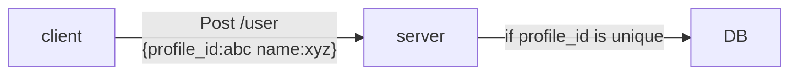
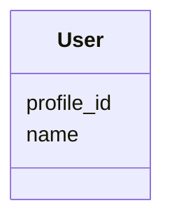
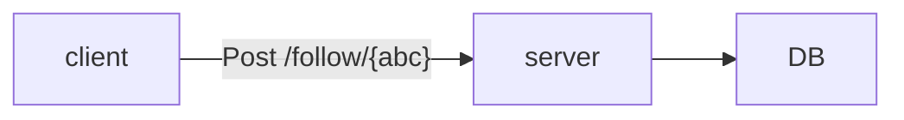
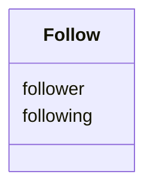
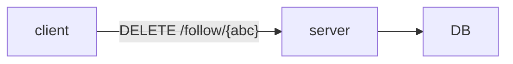
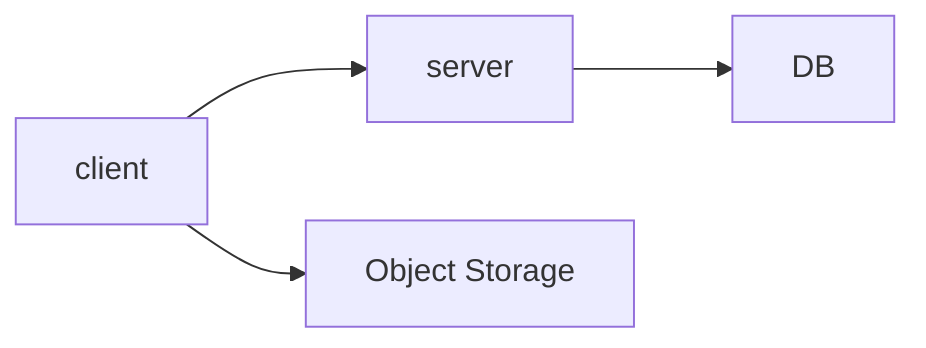
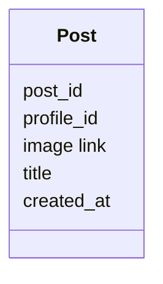
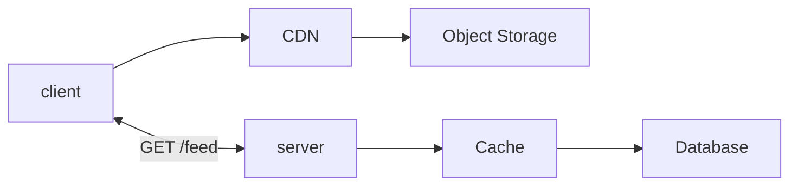
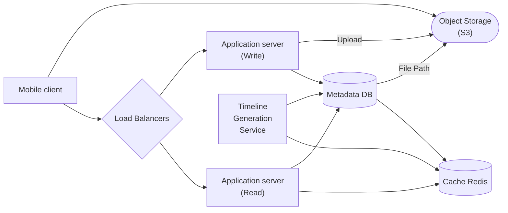

# Requirement
## Functional
1. Users should be able to make profiles 
2. Users  should be able to search profiles by their unique profile id
3. Users should be able to follow other user (as well as unfollow)
4. Users should be able to post posts (Images and Title)
5. Users should be able to see the posts posted by the user they follow
## Non Functional
1. Availability >> Consistency
2. The profile ids should be unique so the user can easily search for any profile
3. Posts should be eventually consistency -> Eventually the post posted by user should be able to seen by their followers
## Back of the Envelope Estimation
- Feed reads: 500M DAU×10 opens/day≈60k reads/sec500M DAU×10 opens/day≈60k reads/sec
- Posts: 100M posts/day≈1,200 posts/sec100M posts/day≈1,200 posts/sec, roughly a **50:1 read-to-write ratio**
- Timeline writes if fanning out on write: 1,200 posts/sec×200 followers≈240k writes/sec1,200 posts/sec×200 followers≈240k writes/sec
- Media: 100M posts/day×2 MB≈200 TB/day100M posts/day×2 MB≈200 TB/day 

The 50:1 read-to-write ratio points toward optimizing reads. But 240k timeline writes per second is still substantial, so precomputing feeds will not be free.

# API
1. POST /users
```
{
name
profile_id
}
->
{
status
}
```
1. GET /users/{profile_id}
2. POST /follow/{profile_id}
3. DELETE /follow/{profile_id}
4. POST /posts 
```
{
image
title
}
->
{
post_id
}
```
6. GET /feed
# Database Design
### User

| Field      | Type   | Details                         |
| :--------- | :----- | :------------------------------ |
| profile_id | int    | primary key, increment serially |
| name       | string |                                 |

### Post

| Field      | Type   | Details                            |
| :--------- | :----- | :--------------------------------- |
| post_id    | int    | primary key, increment serially    |
| profile_id | int    | foreign key referencing to user.id |
| title      | string |                                    |
| created_at | string |                                    |
| image_link | string |                                    |

### Followers

| Field     | Type | Details                            |
| :-------- | :--- | :--------------------------------- |
| follower  | int  | foreign key referencing to user.id |
| following | int  | foreign key referencing to user.id |
# High Level Design
## 1. New User


## 2. Follow



Checks
- The user is not following themself
- The user is not already following the target user
- The target user must exist.
- Add a composite unique constraint on `(follower, following)` in the database.
## 3. Unfollow

Checks
- The user is not unfollowing themself
- The user is following the target user
## 4. Posts


- Upload the image to object storage.
- Once the upload succeeds, create the post record in the database.
- Return the `post_id`.
## 5. Feed



Fan out on write for normal accounts, Fan out on Read for posts from accounts above a follower threshold, and merge both sources when the user reads the feed.

# Final HLD


# Common pitfalls

- **Choosing fan-out on write without addressing celebrity accounts.** This is a common follow-up to the initial design.
- **Storing post content in timelines.** Edits and deletions become a distributed find-and-replace.
- **Routing media through the app tier.** Use presigned uploads and CDN delivery.
- **Unbounded timelines.** Memory grows without limit for users who follow thousands of accounts.
- **Synchronous fan-out.** Posting should not wait on 200 timeline writes.