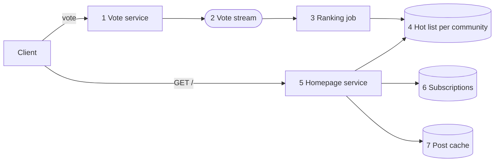

Reddit's homepage has to decide which posts across all your communities are worth showing now. That order keeps changing as votes arrive and posts age, even when nobody publishes anything new.

# Requirements
- Each user gets a homepage assembled from their subscribed communities. 
- A score-and-time function ranks the posts
- The result may lag by about a minute.

# Back-of-envelope numbers
- Reads: 50M DAU×10 loads/day≈6k reads/sec50M DAU×10 loads/day≈6k reads/sec
- Votes: 10M votes/day≈120 votes/sec10M votes/day≈120 votes/sec, spiking far higher on viral posts
- ~100k active communities, of which only a few thousand are busy at any moment

There are far fewer _communities_ than users. That difference lets you precompute one ranked list per community and assemble each user's homepage from those shared lists instead of ranking posts separately for every user.

# High Level Design


Components
1. **Vote service.** Records the vote durably and idempotently, one vote per user per post.
2. **Vote stream.** Decouples voting from ranking so a vote never waits on a recompute.
3. **Ranking job.** Recomputes the top posts for each active community on a short interval.
4. **Hot list.** Keeps a small, ordered list of post IDs for each community in memory.
5. **Homepage service.** Merges hot lists for the user's subscriptions and returns a page.
6. **Subscriptions.** Which communities each user follows.
7. **Post cache.** Hydrates post IDs into titles, thumbnails, and current counts.

# Deep Dive 
## 1. The ranking function, and why it's time-decayed

Sorting only by score would leave the same all-time favorites at the top forever. Combine score with age so older posts gradually fall and new posts have a chance to rise.

```
rank = log10(max(|upvotes - downvotes|, 1)) + (sign × seconds_since_epoch / 45000)
```

 The **logarithm** gives the first ten upvotes more weight than the ten-thousandth, which helps new posts climb. 
 Age is an additive term measured against a fixed epoch. Because time affects every post equally, you only need to recompute a post's score when its votes change; relative order stays intact without rescoring everything.

That second property makes precomputation practical. If the system had to rescore every post every minute, the rest of this design would fall apart.

## 2. Precompute per community, merge per user

Ranking every post a user could see at request time is too expensive. A user subscribed to 50 communities would trigger 50 queries and a merge across hundreds of thousands of posts on every page load.

Instead, **precompute per community** because every subscriber shares the same community list. A ranking job maintains the top few hundred posts for each community. A homepage request fetches the lists for the user's subscriptions, merges them by score, and returns one page. Merging 50 presorted lists of 300 entries takes only milliseconds.

## 3. How often to recompute
The ranking job does not need to touch every community. Most receive only a handful of votes per hour, so their ordering stays stable for long stretches.

- **Recompute active communities frequently.** A community receiving votes in the last minute gets recomputed on a short cycle. Everything else can wait.
- **Recompute cheaply.** You only need to re-score posts whose votes changed, then re-sort a limited candidate set of the top few thousand posts by recency, rather than the community's entire history.
- **Let the front page lag.** With a freshness budget of about a minute, you can batch votes and recompute on an interval instead of reacting to every vote. This saves substantial work, which is why you should ask about freshness up front.

# Common pitfalls

- **Ranking at read time.** Impossible at scale, and it puts the most expensive work on the hottest path.
- **Precomputing per user.** Multiplies work by your user count when the shared unit is the community.
- **Score without time decay.** The homepage freezes on all-time favorites and never turns over.
- **Offset paging over a reordering list.** Users see duplicates and miss posts.
- **Not asking about freshness.** Without a stated budget you'll design for real-time ranking you don't need.