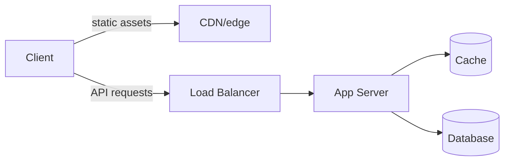

How do systems like Instagram or Amazon serve that traffic without overwhelming the database?
The answer is **read-heavy scaling**: compute an answer once, then serve copies instead of rebuilding it for every reader.
We can cache popular data, spread reads across replicas, and precompute expensive results. 
Each technique improves throughput by storing another copy of the data, which means accepting some amount of staleness.


The client fetches static assets from the CDN and API data through the load balancer, where a cache absorbs most reads before they reach the database.
# The core idea
When the read:write ratio is 100:1 or 10,000:1, it makes sense to **do more work at write time (or asynchronously)** so every read does less work.

We can cache a result so repeated reads never touch the database, or replicate data so several machines serve reads in parallel. For feeds, rankings, and aggregations, we can precompute the answer so the request becomes a key-value lookup instead of a multi-table join.

# The problem: computing answers at read time doesn't scale
Take "design the Instagram home feed" naively. 
When a user opens the app, you look up everyone they follow, fetch recent posts from each account, merge and rank the results, then hydrate each post with author info and like counts. 
That's several joins and aggregations, fanned across shards, on every single app open, for hundreds of millions of daily users. 
The database is overwhelmed long before real scale, and latency is bad even when it doesn't.

The same shape appears everywhere: a product page aggregating inventory, pricing, and reviews; a homepage ranking thousands of posts; a dashboard summing millions of events. 
The naive design recomputes the answer on every read. The pattern says: compute it once, store it, and serve the stored copy.

# Five layers of read scaling

```mermaid
flowchart LR
Client --> LD[Load Balancer]
Client --> CDN/edge
LD --> AS[App Server]
CDN/edge -.->|"| AS
AS --> AC[(App cache)]
AS --> Primary[(Primary)]
AC -.-> RR[(Read Replica)]
Primary -.-> RR
```
