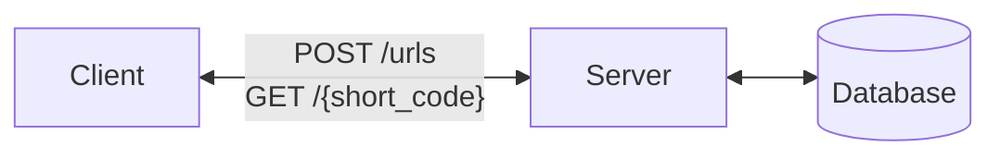
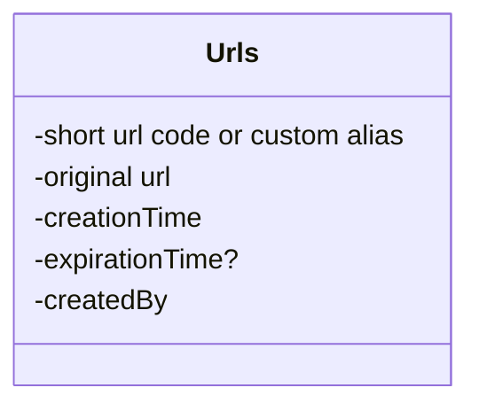

# Functional Requirements
**Core Requirements**
1. Users should be able to submit a long URL and receive a shortened version.
    - Optionally, users should be able to specify a custom alias for their shortened URL (ie. "[www.short.ly/my-custom-alias](http://www.short.ly/my-custom-alias)")
    - Optionally, users should be able to specify an expiration date for their shortened URL.
2. Users should be able to access the original URL by using the shortened URL.

**Below the line (out of scope):**
- User authentication and account management.
- Analytics on link clicks (e.g., click counts, geographic data).

# Non Functional Requirements
**Core Requirements**
1. The system should ensure uniqueness for the short codes (each short code maps to exactly one long URL)
2. The redirection should occur with minimal delay (< 100ms)
3. The system should be reliable and available 99.99% of the time (availability > consistency)
4. The system should scale to support 1B shortened URLs and 100M DAU

**Below the line (out of scope):**
- Data consistency in real-time analytics.
- Advanced security features like spam detection and malicious URL filtering.

# Defining the Core Entities
In a URL shortener, the core entities are very straightforward:

1. **Original URL**: The original long URL that the user wants to shorten.
2. **Short URL**: The shortened URL that the user receives and can share.
3. **User**: Represents the user who created the shortened URL.

# The API

To shorten a URL, we'll need a POST endpoint that takes in the long URL and optionally a custom alias and expiration date, and returns the shortened URL. We use post here because we are creating a new entry in our database mapping the long url to the newly created short url.

```
// Shorten a URL
POST /urls
{
  "long_url": "https://www.example.com/some/very/long/url",
  "custom_alias": "optional_custom_alias",
  "expiration_date": "optional_expiration_date"
}
->
{
  "short_url": "http://short.ly/abc123"
}
```

For redirection, we'll need a GET endpoint that takes in the short code and redirects the user to the original long URL. GET is the right verb here because we are reading the existing long url from our database based on the short code.

```
// Redirect to Original URL
GET /{short_code}
-> HTTP 302 Redirect to the original long URL
```

# High-Level Design


