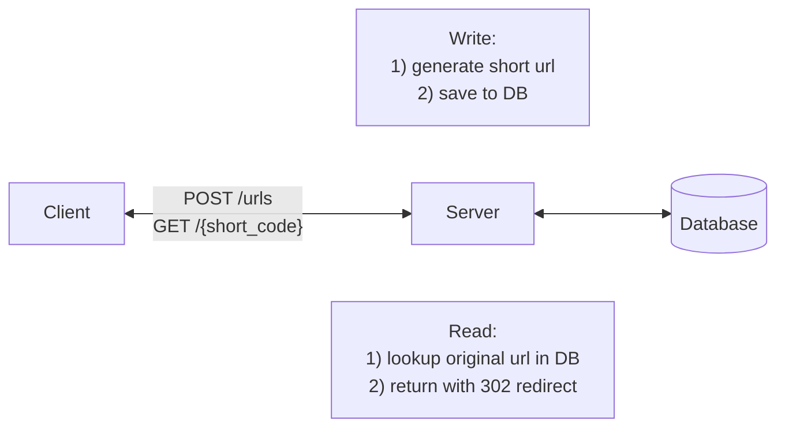
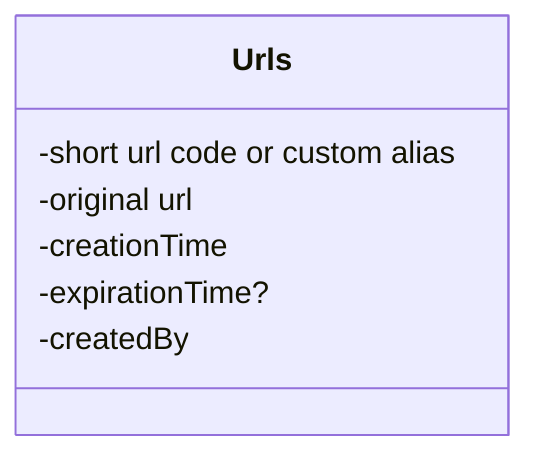

# Functional Requirements
**Core Requirements**
1. Users should be able to submit a long URL and receive a shortened version.
    - Optionally, users should be able to specify a custom alias for their shortened URL (ie. "[www.short.ly/my-custom-alias](http://www.short.ly/my-custom-alias)")
    - Optionally, users should be able to specify an expiration date for their shortened URL.
2. Users should be able to access the original URL by using the shortened URL.

**Below the line (out of scope):**
- User authentication and account management.
- Analytics on link clicks (e.g., click counts, geographic data).

# Non Functional Requirements
**Core Requirements**
1. The system should ensure uniqueness for the short codes (each short code maps to exactly one long URL)
2. The redirection should occur with minimal delay (< 100ms)
3. The system should be reliable and available 99.99% of the time (availability > consistency)
4. The system should scale to support 1B shortened URLs and 100M DAU

**Below the line (out of scope):**
- Data consistency in real-time analytics.
- Advanced security features like spam detection and malicious URL filtering.
# Back of the envelope estimation

- Write operation: 100 million URLs are generated per day.
- Write operation per second: 100 million / 24 /3600 = 1160
- Read operation: Assuming ratio of read operation to write operation is 10:1, read operaion per second: 1160 * 10 = 11,600
- Assuming the URL shortener service will run for 10 years, this means we must support 100 million * 365 * 10 = 365 billion records.
- Assume average URL length is 100.
- Storage requirement over 10 years: 365 billion * 100 bytes = 36.5 TB
# Defining the Core Entities
In a URL shortener, the core entities are very straightforward:

1. **Original URL**: The original long URL that the user wants to shorten.
2. **Short URL**: The shortened URL that the user receives and can share.
3. **User**: Represents the user who created the shortened URL.

# The API

To shorten a URL, we'll need a POST endpoint that takes in the long URL and optionally a custom alias and expiration date, and returns the shortened URL. We use post here because we are creating a new entry in our database mapping the long url to the newly created short url.

```
// Shorten a URL
POST /urls
{
  "long_url": "https://www.example.com/some/very/long/url",
  "custom_alias": "optional_custom_alias",
  "expiration_date": "optional_expiration_date"
}
->
{
  "short_url": "http://short.ly/abc123"
}
```

For redirection, we'll need a GET endpoint that takes in the short code and redirects the user to the original long URL. GET is the right verb here because we are reading the existing long url from our database based on the short code.

```
// Redirect to Original URL
GET /{short_code}
-> HTTP 302 Redirect to the original long URL
```

# High-Level Design



## 1) Users should be able to submit a long URL and receive a shortened version
**When a user submits a long url, the client sends a POST request to /urls with the long url, custom alias, and expiration date.** Then:
1. The Primary Server receives the request and validates the long URL format using libraries like [is-url](https://www.npmjs.com/package/is-url) or simple validation. 
	- Optionally, we can check if this exact long URL was already shortened and return the existing short code (deduplication). 
	- However, most URL shorteners allow multiple short codes for the same long URL since different users may want separate expiration dates, independent analytics, or different custom aliases. 
	- Deduplication trades off storage efficiency for these features.
2. If the URL is valid, we generate a short code
    - If the user has specified a custom alias, we can use that as the short code (after validating that it doesn't already exist). To prevent custom aliases from colliding with future counter-generated codes, consider prefixing generated codes with a character that custom aliases can't use, or store them in separate namespaces.
3. Once we have the short URL, we can proceed to insert it into our database, storing the short code (or custom alias), long URL, and expiration date.
4. Finally, we can return the short URL to the client.
## 2) Users should be able to access the original URL by using the shortened URL
**When a user accesses a shortened URL, the following process occurs:**

1. The user's browser sends a GET request to our server with the short code (e.g., GET /abc123).
2. Our Primary Server receives this request and looks up the short code (abc123) in the database.
3. If the short code is found and hasn't expired (by comparing the current date to the expiration date in the database), the server retrieves the corresponding long URL. For expired URLs, return a 410 Gone status.
4. The server then sends an HTTP redirect response to the user's browser, instructing it to navigate to the original long URL.

For cleanup, we can run a background job periodically to delete expired rows from the database (or just keep them with their expiration date). More importantly, we should set the cache TTL to match or be shorter than URL expiration times so stale entries are automatically evicted.

### There are two main types of HTTP redirects that we could use for this purpose:

1. **301 (Permanent Redirect)**: This indicates that the resource has been permanently moved to the target URL. Browsers typically cache this response, meaning subsequent requests for the same short URL might go directly to the long URL, bypassing our server.

The response back to the client looks like this:

```
HTTP/1.1 301 Moved Permanently
Location: https://www.original-long-url.com
```

2. **302 (Found)**: This indicates that the resource is temporarily located at a different URL. Browsers do not cache this response, ensuring that future requests for the short URL will always go through our server first.

The response back to the client looks like this:

```
HTTP/1.1 302 Found
Location: https://www.original-long-url.com
```

In either case, the user's browser (the client) will automatically follow the redirect to the original long URL and users will never even know that a redirect happened.

### What HTTP redirect to use?
For a URL shortener, a 302 redirect is often preferred because:

- It gives us more control over the redirection process, allowing us to update or expire links as needed.
- It prevents browsers from caching the redirect, which could cause issues if we need to change or delete the short URL in the future.
- It allows us to track click statistics for each short URL (even though this is out of scope for this design).

We can use 301 redirect when
- No delete and update of short url
- No analytics

# Deep Dives

## 1) URL shortening

1. We need to ensure that the short codes are unique.
2. We want the short codes to be as short as possible (it is a url shortener afterall).
3. We want to ensure codes are efficiently generated.
### Hash value length

The _hashValue_ consists of characters from [0-9, a-z, A-Z], containing 10 + 26 + 26 = 62 possible characters. To figure out the length of _hashValue_, find the smallest _n_ such that _62^n ≥ 365 billion_. The system must support up to 365 billion URLs based on the back of the envelope estimation. Table 1 shows the length of _hashValue_ and the corresponding maximal number of URLs it can support.

| **n** | **Maximal number of URLs**                   |
| ----- | -------------------------------------------- |
| 1     | 62^1 = 62                                    |
| 2     | 62^2 = 3,844                                 |
| 3     | 62^3 = 238,328                               |
| 4     | 62^ 4 = 14,776,336                           |
| 5     | 62^5 = 916,132,832                           |
| 6     | 62^6 = 56,800,235,584                        |
| **7** | **62^7 = 3,521,614,606,208 = ~3.5 trillion** |
| 8     | 62^8 = 218,340,105,584,896                   |

When _n = 7, 62 ^ n = ~3.5 trillion_, 3.5 trillion is more than enough to hold 365 billion URLs, so the length of _hashValue_ is 7.
### Random generation with a uniqueness check

Using a random number generator to create short codes involves generating a random number each time a new URL is shortened. This random number serves as the unique identifier for the URL. We can use common random number generation functions like JavaScript's Math.random() or more robust cryptographic random number generators for increased unpredictability. The generated random number would then be used as the short code for the URL. But a random number generator does not provide enough entropy to ensure that our codes are unique.
$\therefore$ A unique constraint on `short_code` makes correctness independent of luck.
### Hash + collision resolution

To shorten a long URL, we should implement a hash function that hashes a long URL to a 7-character string. A straightforward solution is to use well-known hash functions like CRC32, MD5, or SHA-1. The following table compares the hash results after applying different hash functions on this URL:  
`https://en.wikipedia.org/wiki/Systems_design`

|**Hash function**|**Hash value (Hexadecimal)**|
|---|---|
|CRC32|5cb54054|
|MD5|5a62509a84df9ee03fe1230b9df8b84e|
|SHA-1|0eeae7916c06853901d9ccbefbfcaf4de57ed85b|

As shown in Table 2, even the shortest hash value (from CRC32) is too long (more than 7 characters). 

The first approach is to collect the first 7 characters of a hash value; however, this method can lead to hash collisions. To resolve hash collisions, we can recursively append a new predefined string until no more collision is discovered. This process is explained in Figure 5.


This method can eliminate collision; however, it is expensive to query the database to check if a shortURL exists for every request. A technique called bloom filters can improve performance. A bloom filter is a space-efficient probabilistic technique to test if an element is a member of a set. 

### Base 62 Counter

Why base62? It's a compact representation of numbers that uses 62 characters (a-z, A-Z, 0-9). The reason it's 62 and not the more common base64 is because we exclude + and / - the slash is a path separator in URLs and the plus sign can be interpreted as a space in query strings.

One way to guarantee we don't have collisions is to simply increment a counter for each new url. We can then take the output of the counter and encode it using base62 encoding to ensure it's a compacted representation.

Redis is particularly well-suited for managing this counter because it's single-threaded and supports atomic operations. Being single-threaded means Redis processes one command at a time, eliminating race conditions. Its INCR command atomically increments the counter and returns the new value in a single operation. Because Redis is single-threaded, two simultaneous calls will always receive different values. If one gets 1000, the other gets 1001. This guarantee is what makes Redis ideal for distributed counter management.

Each counter value is unique, eliminating the risk of collisions without the need for additional checks. Incrementing a counter and encoding it is computationally efficient, supporting high throughput. With proper counter management, the system can scale horizontally to handle massive numbers of URLs. The short code can be easily decoded back to the original ID if needed, aiding in database lookups.

#### Problems
In a distributed environment, maintaining a single global counter can be challenging due to synchronization issues. All instances of our Primary Server would need to agree on the counter value.

Sequential counters also produce predictable short codes, making URL enumeration possible. An attacker could iterate through codes to discover all URLs.

If this is a concern, apply a reversible transformation (like XOR with a secret key) before base62 encoding, or accept the tradeoff since short URLs are often meant to be shared publicly anyway

### Base 62 conversion
Base conversion is another approach commonly used for URL shorteners. Base conversion helps to convert the same number between its different number representation systems.

Let us use an example to explain how the conversion works: convert 1115710 to base 62 representation (1115710 represents 11157 in a base 10 system).

- From its name, base 62 is a way of using 62 characters for encoding. The mappings are: _0-0, ..., 9-9, 10-a, 11-b, ..., 35-z, 36-A, ..., 61-Z, where_ ‘a’ stands for 10, ‘Z’ stands for 61, etc.
- 1115710 = 2 x 622 + 55 x 621 + 59 x 620 = [2, 55, 59] -> [2, T, X] in base 62 representation. Figure 6 shows the conversation process.


- Thus, the short URL is `https://tinyurl.com/`**2TX**

## 2) Making redirects fast

### Index
An index creates a separate, sorted list of our short URLs, each with a pointer to where the full information is stored in the main table. This allows the database to use efficient search methods, dramatically reducing the time it takes to find a matching URL.

1. B-tree Indexing: Most relational databases use B-tree indexes by default. For our URL shortener, we'd create a B-tree index on the short code column. This provides O(log n) lookup time, which is very efficient for large datasets.
2. Primary Key: We should designate the short code as the primary key of our table. This automatically creates an index and ensures uniqueness. By making the short code the primary key, we get the benefits of both indexing and data integrity, as the database will enforce uniqueness and optimize queries on this field.

With these optimizations in place, our system can now find the matching original URL in a fraction of the time it would take without them. Instead of potentially searching through millions of rows, the database can find the exact match almost instantly, greatly improving the performance of our URL shortener service.

#### Problems
Relying solely on a disk-based database for redirects presents some challenges.

The main challenge lies in the sheer volume of read operations required. With 100M DAU (Daily Active Users), assuming each user performs an average of 5 redirects per day, we're looking at:

100,000,000 users * 5 redirects = 500,000,000 redirects per day 
500,000,000 / 86,400 seconds ≈ 5,787 redirects per second

This assumes redirects are evenly distributed throughout the day, which is unlikely. Most redirects will occur during peak hours, which means we need to design for high-traffic spikes. Multiplying by 100x to handle the spikes means we need to handle ~600k read operations per second.

Even with optimized queries and indexing, a single database instance may struggle to keep up with this volume of traffic. This high read load could lead to increased response times, potential timeouts, and might affect other database operations like URL shortening.

### Implementing an In-Memory Cache (e.g. Redis)

To improve redirect speed, we can introduce an in-memory cache like Redis or Memcached between the application server and the database. This cache stores the frequently accessed mappings of short codes to long URLs. When a redirect request comes in, the server first checks the cache. If the short code is found in the cache (a cache hit), the server retrieves the long URL from the cache, significantly reducing latency. If not found (a cache miss), the server queries the database, retrieves the long URL, and then stores it in the cache for future requests.

The key here is that instead of going to disk we access the mapping directly from memory. This difference in access speed is significant:

- Memory access time: ~100 nanoseconds (0.0001 ms)
- SSD access time: ~0.1 milliseconds
- HDD access time: ~10 milliseconds

This means memory access is about 1,000 times faster than SSD and 100,000 times faster than HDD. In terms of operations per second:

- Memory: Can support millions of reads per second
- SSD: ~100,000 IOPS (Input/Output Operations Per Second)
- HDD: ~100-200 IOPS

#### Problems
- While implementing an in-memory cache offers significant performance improvements, it does come with its own set of challenges. 
- Cache invalidation can be complex, especially when updates or deletions occur, though this issue is minimized since URLs are mostly read-heavy and rarely change. 
- The cache needs time to "warm up," meaning initial requests may still hit the database until the cache is populated. 
- Memory limitations require careful decisions about cache size, eviction policies (e.g., LRU - Least Recently Used), and which entries to store. 
- Introducing a cache adds complexity to the system architecture, and you'll want to be sure you discuss the tradeoffs and invalidation strategies with your interviewer.

### CDN and Edge Computing
Another thing we can do to reduce latency is to utilize Content Delivery Networks (CDNs) and edge computing. In this approach, the short URL domain is served through a CDN with Points of Presence (PoPs) geographically distributed around the world. The CDN nodes cache the mappings of short codes to long URLs, allowing redirect requests to be handled close to the user's location. Furthermore, by deploying the redirect logic to the edge using platforms like Cloudflare Workers or AWS Lambda@Edge, the redirection can happen directly at the CDN level without reaching the origin server.

The benefit here is that, at least for popular short codes, the redirection can happen at the CDN (close to the user) and it never even reaches our Primary Server, meaningfully reducing the latency.

#### Problems
- Ensuring cache invalidation and consistency across all CDN nodes can be complex. 
- Setting up edge computing requires additional configuration and understanding of serverless functions at the edge. 
- Cost considerations come into play, as CDNs and edge computing services may incur higher costs, especially with high traffic volumes. 
- Edge functions may have limitations in execution time, memory, and available libraries, requiring careful optimization of the redirect logic. 
- Lastly, debugging and monitoring in a distributed edge environment can be more challenging compared to centralized servers.