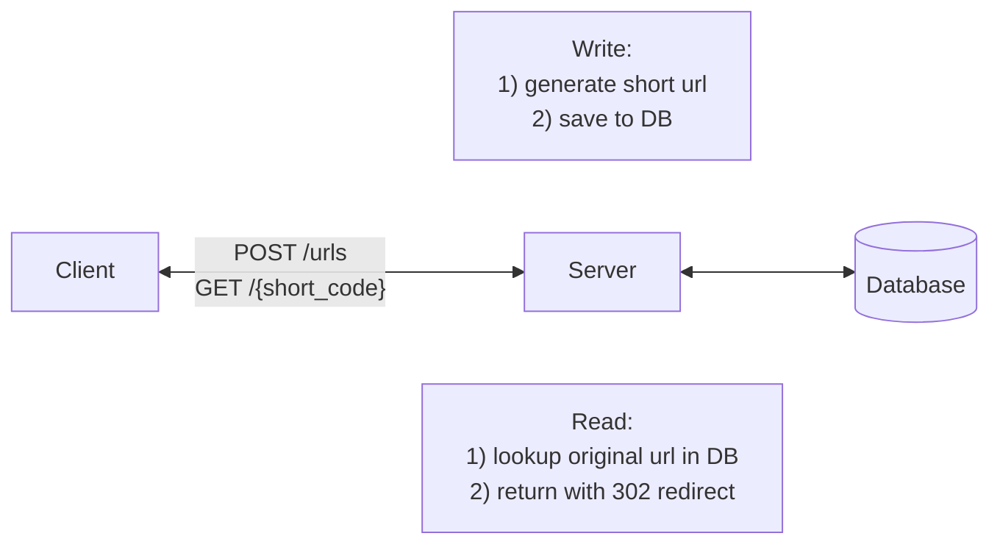
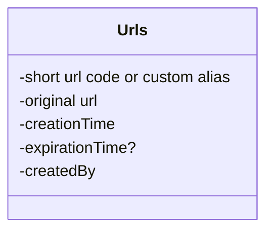

# Functional Requirements
**Core Requirements**
1. Users should be able to submit a long URL and receive a shortened version.
    - Optionally, users should be able to specify a custom alias for their shortened URL (ie. "[www.short.ly/my-custom-alias](http://www.short.ly/my-custom-alias)")
    - Optionally, users should be able to specify an expiration date for their shortened URL.
2. Users should be able to access the original URL by using the shortened URL.

**Below the line (out of scope):**
- User authentication and account management.
- Analytics on link clicks (e.g., click counts, geographic data).

# Non Functional Requirements
**Core Requirements**
1. The system should ensure uniqueness for the short codes (each short code maps to exactly one long URL)
2. The redirection should occur with minimal delay (< 100ms)
3. The system should be reliable and available 99.99% of the time (availability > consistency)
4. The system should scale to support 1B shortened URLs and 100M DAU

**Below the line (out of scope):**
- Data consistency in real-time analytics.
- Advanced security features like spam detection and malicious URL filtering.

# Defining the Core Entities
In a URL shortener, the core entities are very straightforward:

1. **Original URL**: The original long URL that the user wants to shorten.
2. **Short URL**: The shortened URL that the user receives and can share.
3. **User**: Represents the user who created the shortened URL.

# The API

To shorten a URL, we'll need a POST endpoint that takes in the long URL and optionally a custom alias and expiration date, and returns the shortened URL. We use post here because we are creating a new entry in our database mapping the long url to the newly created short url.

```
// Shorten a URL
POST /urls
{
  "long_url": "https://www.example.com/some/very/long/url",
  "custom_alias": "optional_custom_alias",
  "expiration_date": "optional_expiration_date"
}
->
{
  "short_url": "http://short.ly/abc123"
}
```

For redirection, we'll need a GET endpoint that takes in the short code and redirects the user to the original long URL. GET is the right verb here because we are reading the existing long url from our database based on the short code.

```
// Redirect to Original URL
GET /{short_code}
-> HTTP 302 Redirect to the original long URL
```

# High-Level Design



## 1) Users should be able to submit a long URL and receive a shortened version
**When a user submits a long url, the client sends a POST request to /urls with the long url, custom alias, and expiration date.** Then:
1. The Primary Server receives the request and validates the long URL format using libraries like [is-url](https://www.npmjs.com/package/is-url) or simple validation. 
	- Optionally, we can check if this exact long URL was already shortened and return the existing short code (deduplication). 
	- However, most URL shorteners allow multiple short codes for the same long URL since different users may want separate expiration dates, independent analytics, or different custom aliases. 
	- Deduplication trades off storage efficiency for these features.
2. If the URL is valid, we generate a short code
    - If the user has specified a custom alias, we can use that as the short code (after validating that it doesn't already exist). To prevent custom aliases from colliding with future counter-generated codes, consider prefixing generated codes with a character that custom aliases can't use, or store them in separate namespaces.
3. Once we have the short URL, we can proceed to insert it into our database, storing the short code (or custom alias), long URL, and expiration date.
4. Finally, we can return the short URL to the client.
## 2) Users should be able to access the original URL by using the shortened URL
**When a user accesses a shortened URL, the following process occurs:**

1. The user's browser sends a GET request to our server with the short code (e.g., GET /abc123).
2. Our Primary Server receives this request and looks up the short code (abc123) in the database.
3. If the short code is found and hasn't expired (by comparing the current date to the expiration date in the database), the server retrieves the corresponding long URL. For expired URLs, return a 410 Gone status.
4. The server then sends an HTTP redirect response to the user's browser, instructing it to navigate to the original long URL.

For cleanup, we can run a background job periodically to delete expired rows from the database (or just keep them with their expiration date). More importantly, we should set the cache TTL to match or be shorter than URL expiration times so stale entries are automatically evicted.

### There are two main types of HTTP redirects that we could use for this purpose:

1. **301 (Permanent Redirect)**: This indicates that the resource has been permanently moved to the target URL. Browsers typically cache this response, meaning subsequent requests for the same short URL might go directly to the long URL, bypassing our server.

The response back to the client looks like this:

```
HTTP/1.1 301 Moved Permanently
Location: https://www.original-long-url.com
```

2. **302 (Found)**: This indicates that the resource is temporarily located at a different URL. Browsers do not cache this response, ensuring that future requests for the short URL will always go through our server first.

The response back to the client looks like this:

```
HTTP/1.1 302 Found
Location: https://www.original-long-url.com
```

In either case, the user's browser (the client) will automatically follow the redirect to the original long URL and users will never even know that a redirect happened.

### What HTTP redirect to use?
For a URL shortener, a 302 redirect is often preferred because:

- It gives us more control over the redirection process, allowing us to update or expire links as needed.
- It prevents browsers from caching the redirect, which could cause issues if we need to change or delete the short URL in the future.
- It allows us to track click statistics for each short URL (even though this is out of scope for this design).

We can use 301 redirect when
- No delete and update of short url
- No analytics

# Deep Dives

## 1) URL shortening

1. We need to ensure that the short codes are unique.
2. We want the short codes to be as short as possible (it is a url shortener afterall).
3. We want to ensure codes are efficiently generated.