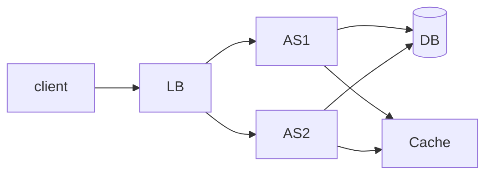

# Requirement
## Functional
1. Users should be able to make profiles 
2. Users  should be able to search profiles by their unique profile id
3. Users should be able to send friend requests.
4. Users should be able to accept or reject friend requests.
5. Users should be able to unfriend existing friends.
6. Users should be able to post posts (Images and Title)
7. Users should be able to see the posts posted by their friends
## Non Functional
1. Availability >> Consistency
2. The profile ids should be unique so the user can easily search for any profile
3. Posts should be eventually consistency -> Eventually the post posted by user should be able to seen by their friends
## Back of the Envelope Estimation

# API
1. POST /new/{profile_id} 
2. GET /{profile_id}
3. POST /friend_request/{profile_id1,profile_id2}
4. POST /request_resposnse/{profile_id1,profile_id2,bool(Yes/No)}
5. DELETE /unfriend/{profile_id1,profile_id2}
6. POST /post 
```
{
image
title
}->
{
post_id
}
```
6. GET /feed/{profile_id}
# High Level Design

