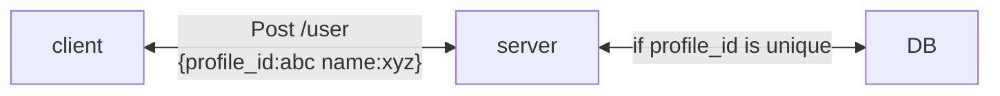
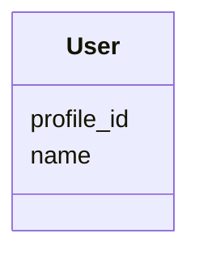
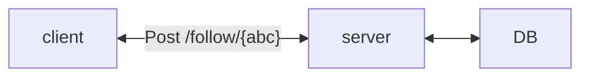
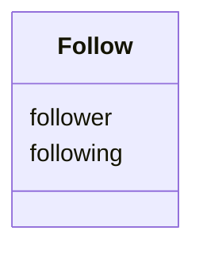
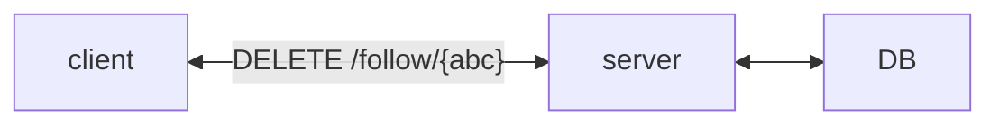
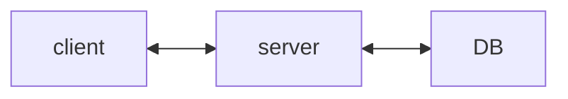
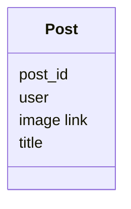
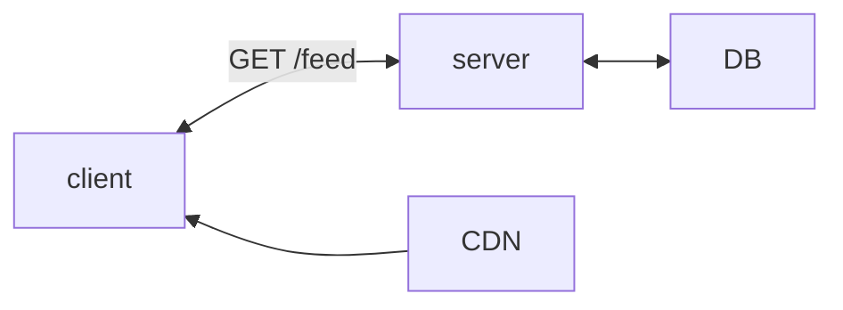

# Requirement
## Functional
1. Users should be able to make profiles 
2. Users  should be able to search profiles by their unique profile id
3. Users should be able to follow other user (as well as unfollow)
4. Users should be able to post posts (Images and Title)
5. Users should be able to see the posts posted by the user they follow
## Non Functional
1. Availability >> Consistency
2. The profile ids should be unique so the user can easily search for any profile
3. Posts should be eventually consistency -> Eventually the post posted by user should be able to seen by their followers
## Back of the Envelope Estimation
# API
1. POST /users
```
{
name
profile_id
}
->
{
status
}
```
1. GET /users/{profile_id}
2. POST /follow/{profile_id}
3. DELETE /follow/{profile_id}
4. POST /posts 
```
{
image
title
}
->
{
post_id
}
```
6. GET /feed
# High Level Design
## 1. New User


## 2. Follow



Checks
- The user is not following themself
- The user is not already following the target user
## 3. Unfollow

Checks
- The user is not unfollowing themself
- The user is following the target user
## 4. Posts


async the uploading of the image for faster response of the API
## 5. Feed

- Get all the following of the user
- Get the top 10 post_id of the the those following in newest to oldest order
- Get the images from the CDN for those post