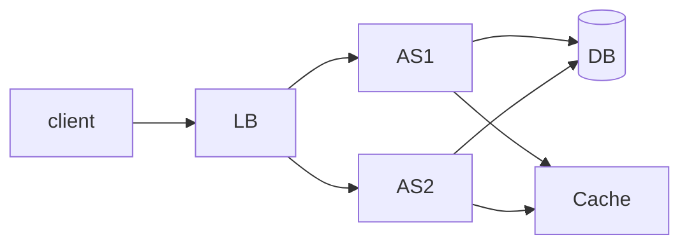

# Requirement
## Functional
1. Users should be able to make profiles 
2. Users  should be able to search profiles by their unique profile id
3. Users should be able to follow other user (as well as unfollow)
4. Users should be able to post posts (Images and Title)
5. Users should be able to see the posts posted by the user they follow
## Non Functional
1. Availability >> Consistency
2. The profile ids should be unique so the user can easily search for any profile
3. Posts should be eventually consistency -> Eventually the post posted by user should be able to seen by their followers
## Back of the Envelope Estimation

# API
1. POST /users/{profile_id} 
2. GET /users/{profile_id}
3. POST /follow/{profile_id}
4. DELETE /unfollow/{profile_id}
5. POST /posts 
```
{
image
title
}
->
{
post_id
}
```
6. GET /feed/{profile_id}
# High Level Design

