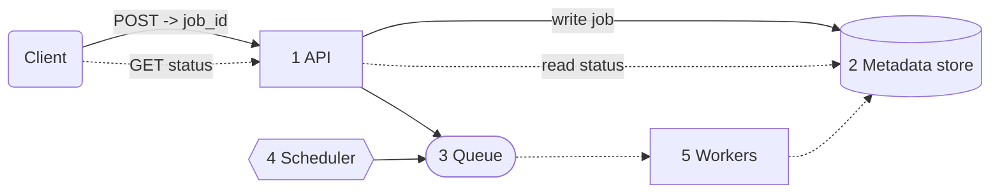
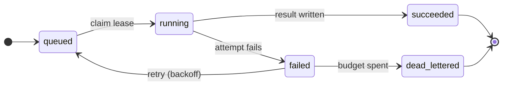

When a user requests a data export or uploads a large video, the work may take minutes or hours. How can the application respond immediately and still finish that work reliably? The answer is the **asynchronous jobs and workers** pattern.

Persist the request as a job, return its ID, and let background workers execute it. The initial request finishes in milliseconds, while the job can report progress and survive retries or worker crashes. We now need to design job state, leases, idempotency, retry policies, and worker capacity.

# The core idea
Request/response works when the operation is short and the user needs its result immediately. Move work into a job when it takes a long time, depends on an unreliable external service, must run later, or needs progress tracking. Video transcoding, data exports, ML inference, email delivery, and scheduled reports all fit this shape.

Instead of finishing the work before responding, persist the user's intent and make the background execution reliable.

# How this relates to event-driven systems
These two patterns look nearly identical on a whiteboard. Both put a queue between a producer and a pool of consumers, both run work outside the request path, and both need retries, idempotency, and a dead-letter path. In practice they often run on the same broker.

The difference is what the message means. In [event-driven systems](<../03. Event-Driven and Pub-Sub Architectures/Event-Driven and Pub-Sub Architectures.md>) the unit is an **event**, a statement of fact like `FileUploaded`, broadcast to whoever cares. Here the unit is a **job**, an instruction to do a specific piece of work like `process_uploaded_file`, addressed to whoever is free. An event says something happened; a job says something needs doing

That shapes what each pattern worries about. Event-driven design is mostly concerned with communication between services: who subscribes, how the schema evolves, whether ordering holds. Async job design is mostly concerned with execution: tracking a job's state, keeping it alive when a worker dies, bounding retries, and scaling the fleet.

They compose naturally, and most real systems use both: `FileUploaded` (event) → `process_file` (job) → `FileIndexed` (event).

# Core Architecture


Components
1. **API.** Validates, writes a durable job record, returns a `job_id` immediately. Does no work itself.
2. **Metadata store.** The source of truth for job state (status, ownership, progress, attempts, result). The client never reads it directly; status polls go back through the API.
3. **Queue or job table.** The dispatch mechanism, deciding which job a worker picks up next.
4. **Scheduler.** Decides _when_ delayed or recurring jobs become eligible. Executes nothing.
5. **Worker pool.** Stateless processes that claim leases, execute, heartbeat, and write terminal status.

The **metadata store** holds the fields that make jobs observable and recoverable. The ones that carry the design:

| Field                            | Purpose                                                         |
| -------------------------------- | --------------------------------------------------------------- |
| `status`                         | created / queued / running / succeeded / failed / dead-lettered |
| `available_at`                   | When the job becomes eligible to run                            |
| `attempt_count` / `max_attempts` | Retry budget tracking                                           |
| `lease_expires_at`               | Worker ownership, so a crashed worker's job can be reclaimed    |
| `idempotency_key`                | Prevents duplicate creation or duplicate side effects           |
Alongside these sit the obvious identifiers and payload (`job_id`, `job_type`, the input, a `result` pointer, and `progress`). The queue answers "which job next?" The metadata store answers everything else: what it is, what state it's in, who owns it, and what happened.

# Job lifecycle
A job is not a queue message. It has a lifecycle, and a failed _attempt_ is not a failed _job_.



Timeouts and cancellation add more transitions. Explicit state lets users see progress, gives retries their attempt counts and error codes, and allows the system to recover jobs with expired leases. Operators can also find stuck jobs and identify the affected tenants.

# Leases and reliable execution

A worker should never own a job forever. It claims a **lease** for a limited period, and if it crashes, the lease expires and another worker retries. Managed queues call this a visibility timeout. In a job table it looks like:

```SQL
UPDATE job_runs
SET status = 'running', claimed_by = 'worker-17',
    lease_expires_at = now() + interval '60 seconds'
WHERE run_id = 'run_123' AND status = 'queued';
```

For long jobs, the worker **heartbeats** to extend the lease and update progress. Final writes should check ownership or use a fencing token, so a stale worker whose lease already expired can't overwrite the status written by its replacement.

A worker can also crash _after_ performing a side effect but _before_ acknowledging completion, so the job runs again. Job execution is therefore at-least-once, and handlers have to make repeated execution safe.